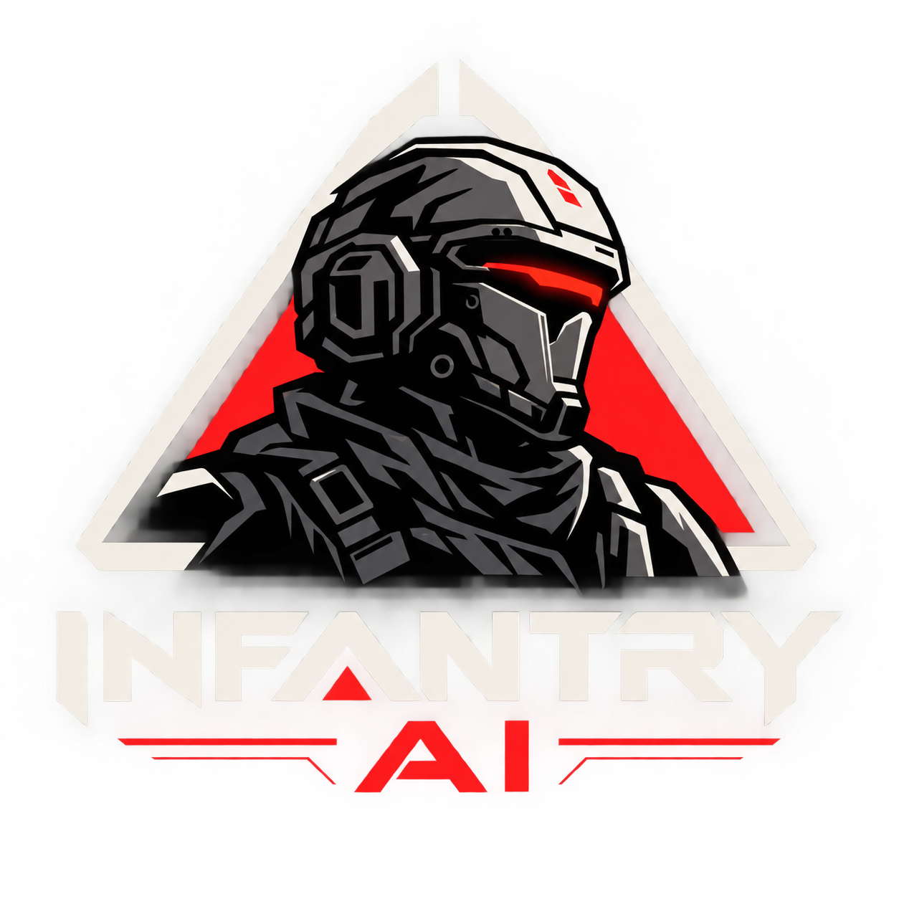

# Infantry AI

Infantry AI (formerly AgentHQ) is a daemon, CLI and desktop/Android UI for running and supervising teams of coding agents
against a ticket board (tickets, roles, mail, shared project knowledge).

Status: **private prototype**. License: pending (none chosen yet).

## Modules (all under `superiorSoftLibrary/`, prefix kept so `:superiorSoftLibrary:*` paths stay valid)

- `agentHq` – daemon + `infantry` CLI (JVM; `agenthq` stays as an alias)
- `agenthqUiCore` – shared UI core (Compose Multiplatform)
- `agentHqUi` – desktop UI
- `agentHqAndroid` – Android shell
- `agentHqHeadless` – test-only guard that the daemon runs with no UI

## Build

Requires JDK 21 (Gradle toolchain resolution via foojay) and, for the Android module, an Android SDK.

    ./gradlew :superiorSoftLibrary:agentHq:compileKotlin :superiorSoftLibrary:agentHqUi:compileKotlin
    ./gradlew :superiorSoftLibrary:agentHq:installDist     # build/install/agenthq/bin/infantry (and agenthq)

Run only one Gradle build at a time. Docs live in `docs/AGENTHQ-*.md`; see `docs/AGENTHQ-INSTALL.md`.

Secrets guard: `./gradlew verifySecretsNotTracked` fails if keys, keystores or tokens are tracked.
Signing secrets belong in `secrets.local.properties` (gitignored) or environment variables.

## Docker (headless daemon)

A headless image of the daemon (no UI) for servers, `infantryai/infantry-ai`. **Not published yet**; build it locally:

    ./gradlew :superiorSoftLibrary:agentHq:dockerContext
    docker build -t infantryai/infantry-ai:dev superiorSoftLibrary/agentHq/build/docker

Run (the token is mandatory, at least 32 characters: the daemon refuses a non-loopback bind without one):

    openssl rand -hex 32 > agenthq_token
    openssl rand -hex 32 > agenthq_keystore_key
    docker run -d --name infantry-ai -p 127.0.0.1:8787:8787 \
      -e AGENTHQ_TOKEN_FILE=/run/secrets/agenthq_token \
      -v ./agenthq_token:/run/secrets/agenthq_token:ro \
      -e AGENTHQ_KEYSTORE_KEY_FILE=/run/secrets/agenthq_keystore_key \
      -v ./agenthq_keystore_key:/run/secrets/agenthq_keystore_key:ro \
      -v agenthq-data:/data infantryai/infantry-ai:dev
    agenthq --url ws://127.0.0.1:8787/ws --token-file ./agenthq_token board

(Git Bash on Windows rewrites `/run/...` into a Windows path: prefix the `docker run` with `MSYS_NO_PATHCONV=1`.)

- **Volume**: `/data` holds the database, logs and state (`AGENTHQ_STATE_DIR`). Keep the same volume across image upgrades.
- **Config**: `AGENTHQ_PORT` (default 8787), `AGENTHQ_HOST` (default `0.0.0.0`), `AGENTHQ_TOKEN` or `AGENTHQ_TOKEN_FILE`
  (e.g. a Docker secret at `/run/secrets/agenthq_token`); other `AGENTHQ_*` variables are read as usual.
- **Health**: `HEALTHCHECK` polls `GET /health` (the one path open without a token).
- **Harness CLIs**: the image ships Node/npm, not the CLIs. Install the ones you use with the built-in installer from any
  client: `agenthq --url ... --token-file ... harness-install claude` (also `opencode`, `pi`); they land in
  `/data/harness-tools`, so they survive container upgrades, and `harness-status` shows them. Sign-in is per CLI: pass the
  provider's API key (`-e ANTHROPIC_API_KEY=...`) or log in once with `docker exec -it infantry-ai claude` and keep the login with
  `-v agenthq-home:/home/agenthq`. A CLI you already have can be mounted instead (`-v /path/to/cli:/usr/local/bin/<name>:ro`).
  Put repos under `/work` (or mount them there).
- **Clients**: the CLI (`--url ws://<host>:8787/ws --token-file <file>`, or a named daemon with `--endpoints <file> --endpoint <name>`)
  and the Android app (connect screen: `ws://<host>:8787/ws`, or `wss://` behind TLS, plus the token). The installed Windows
  app runs its own daemon and has no connect-to-remote option yet.
- **Security**: the token is the only credential and it grants command execution through agents. Never expose the raw port
  to the internet: bind to loopback (`-p 127.0.0.1:8787:8787`) and put a TLS reverse proxy (Caddy, nginx) or a VPN/SSH
  tunnel in front (it must pass WebSocket upgrades). The container runs as non-root (uid 10001). Do not bake the token into an image.

**Keystore key**: the daemon seals its secrets in `/data/keystore.json`. A container has no OS keychain, so mount the master key
and point `AGENTHQ_KEYSTORE_KEY_FILE` at it (as above; `AGENTHQ_KEYSTORE_KEY` also works). Without it the daemon falls back to
`/data/keystore.key`, which is only as safe as the volume. Keep the key file outside the volume and back it up separately.

## Headless download (no Docker)

The same daemon as a plain archive with its own Java runtime bundled (nothing to install), one per OS:
`InfantryAI-server-<version>-windows-x64.zip`, `InfantryAI-server-<version>-linux-x64.tar.gz`,
`InfantryAI-server-<version>-macos-aarch64.tar.gz` on the GitHub Release. Build the one for your machine locally with

    ./gradlew :superiorSoftLibrary:agentHq:headlessDist   # build/distributions/InfantryAI-server-<version>-<os>-<arch>.{zip|tar.gz}

Unpack it and start the daemon (`README.txt` inside lists every setting):

    # Linux / macOS
    AGENTHQ_TOKEN_FILE=./agenthq_token AGENTHQ_HOST=0.0.0.0 ./InfantryAI-server-<version>-linux-x64/bin/agenthq-server.sh
    # Windows (cmd)
    set AGENTHQ_TOKEN_FILE=%CD%\agenthq_token& set AGENTHQ_HOST=0.0.0.0& InfantryAI-server-<version>-windows-x64\bin\agenthq-server.bat

Without `AGENTHQ_HOST` it binds to 127.0.0.1 only. State goes to `~/.agenthq` unless `AGENTHQ_STATE_DIR` says otherwise, so do
not run it next to an installed desktop app on the same state dir and port. `bin/agenthq` in the archive is the CLI, on the
same bundled runtime. Harness CLIs are the machine's own (`agenthq harness-install <id>` needs Node 20+).

## Environment variables

Every `AGENTHQ_*` variable is also read as `INFANTRY_*` (`INFANTRY_PORT`, `INFANTRY_TOKEN`, ...). The old `AGENTHQ_*`
names keep working; when both are set the `AGENTHQ_*` one wins.
