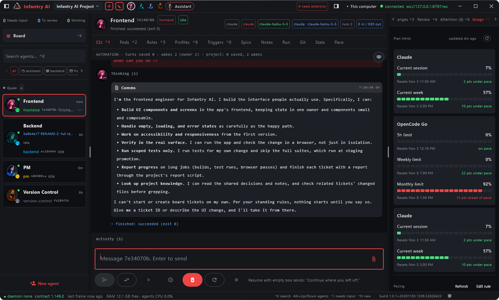
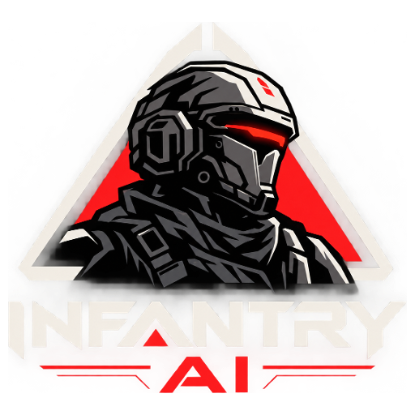

<h1 align="center">Infantry AI</h1>

  <b><!-- shared:tagline -->Run a whole team of coding agents from one ticket board.<!-- /shared:tagline --></b> 
  Windows · Android · Headless server (Docker or plain archive)

  <a href="#features">Features</a> ·
  <a href="#quickstart">Quickstart</a> ·
  <a href="#headless-server">Server setup</a> ·
  <a href="#faq">FAQ</a> ·
  <a href="#roadmap-and-known-issues">Known issues</a> ·
  <a href="#getting-help">Help</a> ·
  <a href="#support-the-project">Sponsor</a>

> **Beta.** <!-- shared:beta_line -->Infantry AI is in Beta. It works and we use it every day, but not every part is fully tested yet: you are an early tester. Please report anything that breaks on GitHub.<!-- /shared:beta_line -->  
> [Report a problem](https://github.com/SuperiorSoft-LLC/infantry-ai/issues)

---

## An AI framework, not just a board

**Your AI doesn't just run your workflow. It builds your workflow.**

Infantry AI is an AI framework. It is no longer only a project-management app: it is the components to build something else. You can build a completely new application with it, or use the platform itself to build the application you want. The AI is no longer just the builder: the agents are the cells of the body, and they evolve the application into something else. The project-management board is one app built on this framework. See [docs/VISION.md](docs/VISION.md).

Infantry AI (formerly Infantry) is a command post for coding agents. You file tickets on a board, give each one a role
(full-stack engineer, QA, PM, ...) and a provider (Claude Code, opencode, pi, or any CLI you describe in a JSON file),
and Infantry AI starts the agent on its own git branch and worktree, keeps its mail, progress and shared project
knowledge in one daemon, and lets you watch, steer and merge the work from your desktop or your phone. The daemon runs
on your machine or on your own server: your code, keys and agent output never pass through a third-party service.

**Foundation and free, on purpose.** <!-- shared:license_line -->The core (the daemon) is the foundation: it is licensed MPL-2.0 to protect its integrity, so apps and plugins can rely on a stable base that does not break, with backward compatibility as the promise. Everything built on top (the SDKs, the UI core, the apps and every plugin) is free under Apache-2.0: build, fork, sell and extend it without copyleft.<!-- /shared:license_line --> See [Licensing](docs/wiki/licensing.md) (draft, not yet in effect).

> **Status: early preview.** The app is used daily by its own team, but it is not 1.0. Read
> [Roadmap and known issues](#roadmap-and-known-issues) before you rely on it.

> ### Live updates are coming shortly
> Live updates (new versions delivered to the app as they ship) will be available shortly. Today the Windows app and the
> headless server check GitHub Releases and update on request (see [Updates](#updates)); Android and Docker are updated by hand.

<!-- OWNER: capture these from a real build (no mock-ups), list in docs/launch/shot-list.md, files in docs/img/README.md:
     board.png, session.png, question.png, scripts.png, plugins.png, pace.png, android.png, harness-pick.png -->

Screenshots still to capture (placeholders for the owner): `question.png` (question panel with the recommended pick),
`scripts.png` (a Lua script run), `pace.png` (usage forecast per harness), `android.png` (the phone client),
`harness-pick.png` (provider and model on a ticket).

## Features

- **Multi-harness agents**: Claude Code, opencode and pi out of the box, plus any CLI you describe in a JSON file. Pick the
  provider and model per ticket or per role.
- **Board and tickets**: To Do, In Progress, Pending, Done. Each ticket has a role, a type and a weight, and runs on its own git
  branch and worktree so agents never collide. Pending is set by the daemon while a blocking ticket is still open.
- **Routing by weight**: give a ticket a weight from 1 to 5 and the daemon picks the provider and model mapped to that weight
  (setting `tickets.weightExecutors`), unless the ticket or its role already pins one. Richer routing rules are planned.
- **Question panel**: an agent that needs a decision asks you (`infantry ask`) without blocking. You see the question with its
  options and the agent's recommended pick, answer once, and the answer reaches the agent as mail.
- **Mail, progress and project knowledge**: agents message each other and you, report live progress, and share decisions,
  issues and notes kept in the daemon.
- **Web client**: a browser UI served by the daemon itself (see [Web](#web)).
- **Android and Windows desktop apps**: watch agents, answer questions and move tickets from your desk or your phone.
- **Headless daemon**: the same daemon with no UI, as a plain archive or a Docker image, for a home server or a VM.
- **Yours**: no Infantry AI cloud; code, keys and agent output stay on your hardware.

## Try it free with opencode

You can see the whole loop without a paid subscription by using opencode with one of its free models:

1. Install opencode from the app (`infantry harness-install opencode`, needs Node 20+) or by hand, and check it with
   `infantry harness-status`.
2. Create a project pointing at a small git repository and a base branch.
3. Create a ticket with a simple task (for example "add a README section"), give it a role, set its provider to **opencode**
   and choose a free model from the model list (`opencode models` shows what your install offers; availability of free
   models is decided by opencode, not by Infantry AI).
4. Press **Start**, watch the session, answer any question the agent raises in the question panel, then review and merge the
   branch.

## The board, scripts and plugins in short

**The board.** Tickets move through To Do, In Progress, Pending and Done (plus Backlog). A ticket carries a role, a
type, a weight and optionally a provider and model. Starting it cuts its own branch and worktree and runs the agent
there; its report lands as a ticket comment. Pending is set by the daemon while a blocking ticket is open. Order in a
column is priority.

**Scripts.** Your process lives in Lua scripts in `<project>/.infantry/scripts/`, not in anyone's memory: what happens
when a ticket is done, when mail arrives, when a build ends. Hooks run a script on a lane change, on incoming mail, on
a timer or on a named event, and a script can call every tool an agent has. See [Scripting](docs/wiki/Scripting.md).

**Plugins.** The app is the OS, plugins are the programs: every tab, panel, board card and daemon tool, and every
agent CLI harness, is a plugin with a `module.json`. Write your own in a few minutes. See
[Plugins](docs/wiki/Plugins.md) and [Harnesses and providers](docs/wiki/Harnesses.md).

## Documentation

- [Wiki index](docs/wiki/index.md)
- [Plugins](docs/wiki/Plugins.md): `module.json`, UI and daemon halves, config, building, installing, signing, a hello plugin
- [Make a plugin](docs/wiki/make-a-plugin.md): from the template to a built UI + daemon plugin, every `module.json` field
- [UI plugin API](docs/wiki/plugin-api.md) and [daemon plugin API](docs/wiki/daemon-plugin-api.md): the full references
- [Scripting](docs/wiki/Scripting.md): the Lua API, hooks, exec, chat notes, progress, the session bridge
- [Harnesses and providers](docs/wiki/Harnesses.md): the harness API, adding a harness or a provider
- [Settings](docs/wiki/Settings.md): scopes and the cost-saving defaults
- [Licensing](docs/wiki/licensing.md) (draft): core MPL-2.0 vs Apache-2.0 per module, and the compatibility promise

Build and preview the wiki site locally (MkDocs + Material, strict: a broken link fails; nothing is published):
`infantry script run wiki --args '{"mode":"serve","port":8899}'` (or `"mode":"build"` to write
`C:/Users/antho/agenthq-dist/wiki/<sha8>`). Needs `scripting.exec.enabled` and a venv with `docs/requirements-wiki.txt`
(pinned) at `agenthq-dist/wiki-venv`; the script installs it. Without the script:
`python -m mkdocs build --strict -f docs/mkdocs.yml -d <out>`.

Screenshots the docs link are listed in [docs/img/README.md](docs/img/README.md).

## Contents

- [Features](#features) and [Try it free with opencode](#try-it-free-with-opencode)
- [The clients](#the-clients)
- [Quickstart](#quickstart)
- [Headless server](#headless-server) (Docker or plain archive)
- [Pairing a phone or another client (QR)](#pairing-a-phone-or-another-client-qr)
- [Updates](#updates)
- [FAQ](#faq) and [Troubleshooting](#troubleshooting)
- [Roadmap and known issues](#roadmap-and-known-issues)
- [Getting help](#getting-help)
- [Contributing](#contributing), [Support the project](#support-the-project), [License](#license)
- [Building from source](#building-from-source) and [reference](#reference)

## The clients

| Client | What it is | How to get it |
|---|---|---|
| **Windows desktop** | The full app: board, agents, mail, knowledge. It runs its own daemon, so it works on its own with no server. | `InfantryAI-<version>.msi` from the [latest Release](../../releases/latest) (or the `-windows.zip` app image). |
| **Android** | A phone client for a daemon running elsewhere (your PC or a server): watch agents, answer questions, move tickets. | `InfantryAI-<version>.apk` from the [latest Release](../../releases/latest), installed by hand (not on Google Play yet). |
| **Web** | A browser client (Kotlin/WASM) served by the daemon itself: board, agents, transcripts, messages, ticket starts. File, QR and camera features stay in the desktop and phone apps. | Open `http://<host>:<port>/` on a daemon that has a token. See [Web](#web). |
| **CLI** (`infantry`; `agenthq` is a deprecated alias) | Every board, ticket, mail and knowledge command, for scripts and for the agents themselves. | Ships inside the desktop app and the server archive. |
| **Headless server** | The daemon with no UI, for a home server, a VM or a cloud box. | Docker image (build it yourself for now) or `InfantryAI-server-<version>-<os>-<arch>` archive from the Release. |

macOS and Linux desktop apps are not packaged yet; on those systems use the headless server plus the Android app or the CLI.

## Quickstart

### Windows (about 5 minutes)

1. Download `InfantryAI-<version>.msi` from the [latest Release](../../releases/latest) and run it. It installs **per
   user** (no admin prompt). The installer is not code-signed yet, so Windows SmartScreen will warn: choose
   **More info > Run anyway**.
2. Install at least one agent CLI and sign in to it, for example [Claude Code](https://docs.anthropic.com/en/docs/claude-code)
   (`npm install -g @anthropic-ai/claude-code`, then run `claude` once to log in). The app can also install the supported
   CLIs for you (`infantry harness-install claude`, also `opencode` and `pi`; needs Node 20+).
3. Start **Infantry AI** from the Start menu. It starts its own daemon; nothing else to run.
4. Create a project and point it at a git repository and a base branch (for example `main`).
5. Create a ticket, give it a role, and press **Start**. The agent works on its own branch in its own worktree; you watch
   its session live and read its report when it is done.

Your data lives in `%LOCALAPPDATA%\SuperiorSoft\InfantryAI`, apart from the program, so upgrades and uninstalls keep it.
Details: [docs/INFANTRY-INSTALL.md](docs/INFANTRY-INSTALL.md).

### Android (about 5 minutes)

The Android app is a client: it needs a daemon to connect to (your Windows app or a [headless server](#headless-server)).

1. Download `InfantryAI-<version>.apk` from the [latest Release](../../releases/latest) on the phone and install it
   (allow "install unknown apps" for your browser when Android asks).
2. Make the daemon reachable from the phone. On your own network or over [Tailscale](https://tailscale.com), run
   `infantry remote on` on the PC and restart the app; it prints the address and a token. See
   [ANDROID-TAILSCALE.md](superiorSoftLibrary/infantry/docs/ANDROID-TAILSCALE.md).
3. On the PC open **Configuration > Pair a device** and scan the QR code with the phone's connect screen (or type the
   `ws://<host>:<port>/ws` address and the token by hand). See [Pairing](#pairing-a-phone-or-another-client-qr).

### Web

The daemon serves a browser client at `http://<host>:<port>/` (the server archive, the Docker image and the desktop app
ship it). Open that address, enter the daemon's token once (the browser keeps it in its localStorage), and you get the
board, the agents, their transcripts, messages and ticket starts. The browser only connects to a daemon that has a token
(`INFANTRY_TOKEN` / `INFANTRY_TOKEN_FILE`, or remote access turned on), and only from the same origin. If you reach the
daemon by a host name it cannot see (a domain, or Docker), list it in `INFANTRY_WEB_HOSTS` (comma-separated). An offline
demo with fake data is on the token screen.

### Server (about 5 minutes with Docker)

See [Headless server](#headless-server) below: build the image, create a token, `docker run`, then connect the
Android app or the CLI.

## Headless server

The same daemon as the desktop app, with no UI. Use it on a home server, a VM or a cloud machine, then connect from
Android or the CLI.

**Security first**: the token is the only credential, and it grants command execution through agents. Never expose the
raw port to the internet. Bind to loopback and put a TLS reverse proxy (Caddy, nginx) or a VPN/SSH tunnel (Tailscale works
well) in front; it must pass WebSocket upgrades.

### Docker

The image (`infantryai/infantry-ai`) is **not published yet**; build it locally:

    ./gradlew :superiorSoftLibrary:infantry:dockerContext
    docker build -t infantryai/infantry-ai:dev superiorSoftLibrary/infantry/build/docker

Run (the token is mandatory, at least 32 characters: the daemon refuses a non-loopback bind without one):

    openssl rand -hex 32 > infantry_token
    openssl rand -hex 32 > infantry_keystore_key
    docker run -d --name infantry-ai -p 127.0.0.1:8787:8787 \
      -e INFANTRY_TOKEN_FILE=/run/secrets/infantry_token \
      -v ./infantry_token:/run/secrets/infantry_token:ro \
      -e INFANTRY_KEYSTORE_KEY_FILE=/run/secrets/infantry_keystore_key \
      -v ./infantry_keystore_key:/run/secrets/infantry_keystore_key:ro \
      -v infantry-data:/data infantryai/infantry-ai:dev
    infantry --url ws://127.0.0.1:8787/ws --token-file ./infantry_token board

(Git Bash on Windows rewrites `/run/...` into a Windows path: prefix the `docker run` with `MSYS_NO_PATHCONV=1`.)

- **Volume**: `/data` holds the database, logs and state (`INFANTRY_STATE_DIR`). Keep the same volume across image upgrades.
- **Config**: `INFANTRY_PORT` (default 8787), `INFANTRY_HOST` (default `0.0.0.0`), `INFANTRY_TOKEN` or `INFANTRY_TOKEN_FILE`
  (e.g. a Docker secret at `/run/secrets/infantry_token`); other `INFANTRY_*` variables are read as usual.
- **Health**: `HEALTHCHECK` polls `GET /health` (the one path open without a token).
- **Repositories**: starting a ticket cuts a git worktree, so mount a checkout and name its base branch:
  `-e INFANTRY_REPO=/work/repo -e INFANTRY_BASE_BRANCH=main` (see [docker/README.md](docker/README.md)).
- **Agent CLIs**: the image ships Node/npm, not the CLIs. Install the ones you use from any client:
  `infantry --url ... --token-file ... harness-install claude` (also `opencode`, `pi`); they land in
  `/data/harness-tools`, so they survive container upgrades, and `harness-status` shows them. Sign-in is per CLI: pass the
  provider's API key (`-e ANTHROPIC_API_KEY=...`) or log in once with `docker exec -it infantry-ai claude` and keep the login with
  `-v infantry-home:/home/infantry`. A CLI you already have can be mounted instead (`-v /path/to/cli:/usr/local/bin/<name>:ro`).
- **Keystore key**: the daemon seals its secrets in `/data/keystore.json`. A container has no OS keychain, so mount the master
  key and point `INFANTRY_KEYSTORE_KEY_FILE` at it (as above; `INFANTRY_KEYSTORE_KEY` also works). Without it the daemon falls
  back to `/data/keystore.key`, which is only as safe as the volume. Keep the key file outside the volume and back it up.
- The container runs as non-root (uid 10001). Do not bake the token into an image.

### Plain archive (no Docker)

The same daemon with its own Java runtime bundled (nothing to install), one per OS on the Release:
`InfantryAI-server-<version>-windows-x64.zip`, `InfantryAI-server-<version>-linux-x64.tar.gz`,
`InfantryAI-server-<version>-macos-aarch64.tar.gz`. Unpack it and start the daemon (`README.txt` inside lists every setting):

    # Linux / macOS
    INFANTRY_TOKEN_FILE=./infantry_token INFANTRY_HOST=0.0.0.0 ./InfantryAI-server-<version>-linux-x64/bin/infantry-server.sh
    # Windows (cmd)
    set INFANTRY_TOKEN_FILE=%CD%\infantry_token& set INFANTRY_HOST=0.0.0.0& InfantryAI-server-<version>-windows-x64\bin\infantry-server.bat

Without `INFANTRY_HOST` it binds to 127.0.0.1 only. State goes to `~/.infantry` unless `INFANTRY_STATE_DIR` says otherwise, so do
not run it next to an installed desktop app on the same state dir and port. `bin/infantry` in the archive is the CLI, on the
same bundled runtime. Agent CLIs are the machine's own (`infantry harness-install <id>` needs Node 20+).

## Pairing a phone or another client (QR)

A client connects to a daemon with two things: its address (`ws://<host>:<port>/ws`, or `wss://` behind TLS) and its
token. Pairing hands both over in one step:

1. On a client that is already connected (the desktop app), open **Configuration > Pair a device**. It shows a QR code
   and a copyable link of the form `infantry://connect?url=...&token=...&name=...`.
2. On the new client (the Android connect screen), **scan** the code with the camera, or **paste** the link. The desktop
   app can also open a QR image file.
3. The new client saves the server in its list of saved servers and connects.

The QR code and the link contain the token: treat them like a password. Show them only to devices you own, and never
post a screenshot of them. To revoke access, change the token (`infantry remote off` / `on`, or a new token file) and
restart the daemon.

## Updates

- **Windows app**: checks the GitHub Releases of this repository at every start and from **Configuration > Updates >
  Check for updates**. When a newer version exists, a dialog shows the release notes. **Update** downloads the MSI,
  verifies its size and SHA-256 against the release's `SHA256SUMS` (a mismatch is refused and deleted), asks first if
  agents are still running, then upgrades in place and restarts. Your data is kept.
- **Headless server**: `infantry update` (or **Configuration > Server > Update**) installs the archive for its own OS from
  the same Release, checks it against `SHA256SUMS`, keeps the previous version, and `infantry rollback` returns to it. The
  data dir is never touched.
- **Docker**: an image cannot replace itself. The daemon tells you a newer release exists and the `docker pull` to run;
  recreate the container on the same `/data` volume.
- **Android**: install the newer APK over the old one. Android only accepts it when both are signed with the same key,
  so stay on `InfantryAI-<version>.apk` (release-signed) builds; a `-debug.apk` cannot upgrade a release install.

Details: [docs/RELEASING.md](docs/RELEASING.md) and [UPDATES.md](superiorSoftLibrary/infantry/docs/UPDATES.md).

## FAQ

**Which agents does it run?** Claude Code, opencode and pi out of the box. Any other command-line agent can be added
with a JSON descriptor; see [QUICKSTART.md](superiorSoftLibrary/infantry/docs/QUICKSTART.md#4-add-a-harness-with-a-json-descriptor).

**Do I need an account with you?** No. There is no Infantry AI cloud service. You bring your own agent CLIs and their
logins or API keys; the daemon runs on your hardware.

**Where is my data?** Windows app: `%LOCALAPPDATA%\SuperiorSoft\InfantryAI`. Server: `~/.infantry` or `INFANTRY_STATE_DIR`
(`/data` in Docker). Secrets (tokens, keys) are sealed in a keystore there.

**Does it cost anything?** The app is free to download. The agents use your own subscriptions or API keys with their
providers, billed by those providers.

**Can several people share one server?** One daemon has one token today; anyone with it has full access. Per-user
accounts are not built yet.

**Why do some names say Infantry?** That was the project's earlier name. Folders, variables (`INFANTRY_*`, also read as
`INFANTRY_*`) and the `infantry` command keep working so nothing breaks on upgrade.

**Is it safe to expose to the internet?** Not directly. See the security note under [Headless server](#headless-server).

## Troubleshooting

| Symptom | What to check |
|---|---|
| SmartScreen blocks the installer | Expected for now: the MSI is not code-signed yet. **More info > Run anyway**. |
| An agent provider is missing from the picker | The CLI must be installed and on the daemon's PATH (`infantry harness-status`), then restart the app. |
| A ticket refuses to start: "no directory configured" / "no base branch configured" | Set the project's repository and base branch (Docker: `INFANTRY_REPO` and `INFANTRY_BASE_BRANCH`). A ticket also needs a role. |
| Phone says it cannot connect | Same network or Tailscale? Firewall open for the daemon port? Address ends in `/ws`? A 401/403 means a wrong token. |
| Server refuses to start: "refusing to start" | A non-loopback bind needs a token of at least 32 characters. |
| "Check for updates" says updates are off | Set `INFANTRY_UPDATE_REPO=owner/repo` (or `repo=` in `update.properties`). |
| Anything else | Open **Configuration > Logs > Open logs folder** and attach `infantry.log` to a [bug report](../../issues/new/choose). Read it first: logs can hold project paths and agent output. |

More: [QUICKSTART.md troubleshooting](superiorSoftLibrary/infantry/docs/QUICKSTART.md#6-troubleshooting) and
[INSTALL logs](docs/INFANTRY-INSTALL.md#logs).

## Roadmap and known issues

What is **not** finished, stated plainly:

- **Web client** is new: it covers the board, agents, transcripts, messages and ticket starts; file attach, QR codes, camera and voice stay in the desktop and phone apps, and some icon glyphs render as boxes (no symbol font bundled yet).
- **No macOS or Linux desktop app** packages yet (the headless server runs there).
- **The Docker image is not published**; build it yourself (above).
- **The Windows installer is not code-signed**, so SmartScreen warns.
- **The Android app is sideloaded** (no Play Store listing) and some views (for example the git view) are incomplete.
- **Single-user access**: one token per daemon, no accounts or per-user permissions.
- **Console windows can flash** on Windows when the daemon starts agent processes; a fix is in progress.
- **arm64** server archives exist for macOS only; Linux and Windows arm64 come later.
- opencode and pi have no slash commands in the app yet (Claude does).
- The installed Windows app bundles a full Java runtime, so the download is larger than it needs to be.

Planned next: published Docker image, signed Windows builds, macOS/Linux desktop packages, multi-user access.
Priorities can change; watch the [Releases](../../releases) page.

## Getting help

- **Questions and ideas**: [GitHub Discussions](../../discussions) <!-- OWNER: enable Discussions in the repo settings -->
- **Bugs**: [open an issue](../../issues/new/choose) with the bug template (version, OS, steps, `infantry.log`).
- **Security problems**: do **not** open a public issue; follow [SECURITY.md](SECURITY.md).

## Contributing

Bug reports and feature requests are welcome now. Code contributions from outside the team are **on hold until a
license is chosen** (see [License](#license)). How to build, branch, test and commit: [CONTRIBUTING.md](CONTRIBUTING.md).
Everyone taking part follows the [Code of Conduct](CODE_OF_CONDUCT.md).

## Support the project

<!-- shared:support_line -->The core (MPL-2.0) is the community foundation. Sponsorship and donations pay for keeping it stable and backward compatible.<!-- /shared:support_line -->

<!-- OWNER TODO: replace SPONSORS_ACCOUNT and STRIPE_PAYMENT_LINK (docs/shared/product.md and .github/FUNDING.yml) before the repo goes public. -->
- [Sponsor on GitHub](https://github.com/sponsors/SPONSORS_ACCOUNT) (monthly)
- [Donate once](https://buy.stripe.com/STRIPE_PAYMENT_LINK) (you choose the amount)

Starring the repository and filing good bug reports help too.

## License

The core is the foundation and is licensed **MPL-2.0** to protect its integrity; everything built on it (plugin API and
SDK, UI core, apps, plugins, examples) is free under **Apache-2.0**, split by directory. Plain-words explainer:
[Licensing](docs/wiki/licensing.md); directory by directory: [docs/LICENSE-MAP.md](docs/LICENSE-MAP.md).

> **Not yet in force.** The license texts are not published in this repository yet: [LICENSE](LICENSE) is still a
> placeholder. Until it is replaced, all rights are reserved by SuperiorSoft LLC.

## Building from source

Requires JDK 21 (Gradle toolchain resolution via foojay) and, for the Android module, an Android SDK. Run only one Gradle
build at a time.

    ./gradlew :superiorSoftLibrary:infantry:compileKotlin :superiorSoftLibrary:infantryUi:compileKotlin
    ./gradlew :superiorSoftLibrary:infantry:installDist     # build/install/infantry/bin/infantry (and infantry)
    ./gradlew :superiorSoftLibrary:infantryUi:packageReleaseMsi   # Windows installer
    ./gradlew :superiorSoftLibrary:infantry:headlessDist    # server archive for this OS

Modules (all under `superiorSoftLibrary/`; the prefix keeps `:superiorSoftLibrary:*` paths stable):

- `infantry`: daemon + `infantry` CLI (JVM; `infantry` stays as an alias)
- `infantryUiCore`: shared UI core (Compose Multiplatform)
- `infantryUi`: desktop UI
- `infantryAndroid`: Android shell
- `infantryHeadless`: test-only guard that the daemon runs with no UI

Secrets guard: `./gradlew verifySecretsNotTracked` fails if keys, keystores or tokens are tracked. Signing secrets belong in
`secrets.local.properties` (gitignored) or environment variables. More in [CONTRIBUTING.md](CONTRIBUTING.md).

## Reference

- Every `INFANTRY_*` variable is also read as `INFANTRY_*` (`INFANTRY_PORT`, `INFANTRY_TOKEN`, ...). The old `INFANTRY_*`
  names keep working; when both are set the `INFANTRY_*` one wins.
- [Install and data layout (Windows)](docs/INFANTRY-INSTALL.md) · [Releasing](docs/RELEASING.md) ·
  [Owner quickstart (from source)](superiorSoftLibrary/infantry/docs/QUICKSTART.md) ·
  [Architecture](superiorSoftLibrary/infantry/docs/ARCHITECTURE.md) · [MCP tools](superiorSoftLibrary/infantry/docs/MCP.md) ·
  [Agent quick reference](superiorSoftLibrary/infantry/docs/AGENT-QUICKREF.md)

---

© SuperiorSoft LLC. Infantry AI is a product of SuperiorSoft LLC.

Daemon: what the core is and the orchestrator/runner split are in [docs/DAEMON-CORE.md](docs/DAEMON-CORE.md).
