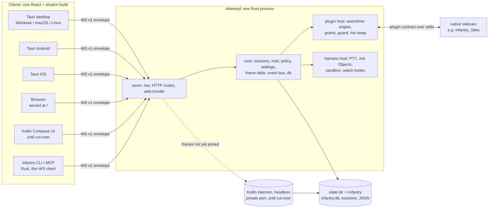
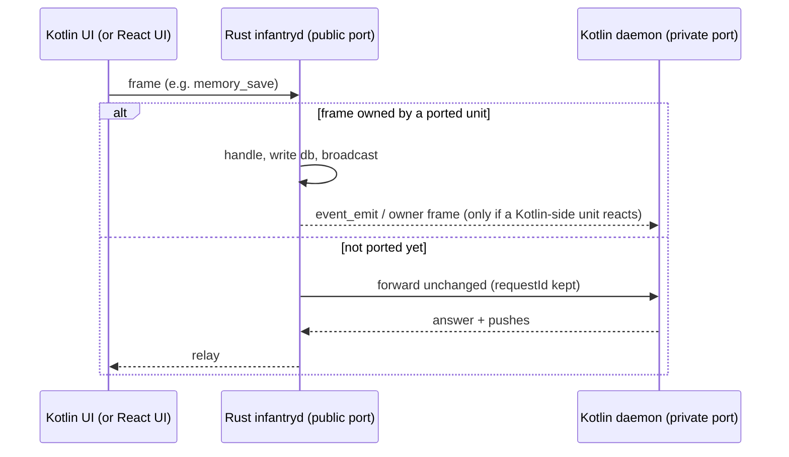
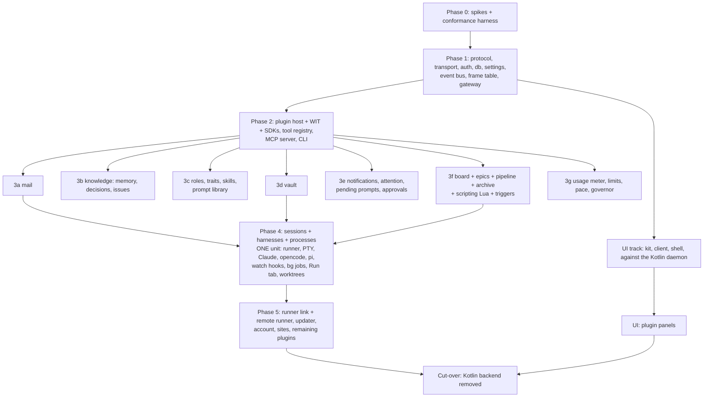

# RUST-PORT-1: plan to rebuild Infantry AI as a Rust daemon and a Tauri v2 / React / shadcn UI

Design record, 2026-11-18 (ticket f4afe954, epic "Rust Port"). **Status: a plan for the owner to approve.** No tickets
exist and no code is written.

The current Kotlin codebase is the specification. Where this plan and the code disagree, the code wins. The plan was
built from these sources:

- the wire contract `superiorSoftLibrary/infantry/CONTRACT.md`;
- `infantryProtocol`, `infantryDaemonApi`, `infantryHarnessApi` and `infantryPlugins` (`ModuleManifest`);
- the daemon (`DaemonMain.kt`, `DaemonPluginHost.kt`, `PluginGuard.kt`), core (`SessionManager`, the keystore,
  settings, the db) and `infantryRunner`;
- the 49 official plugins and the Calendar plugin (branch `feature-calendar`).

Owner requirements this plan treats as fixed:

- **The UI is Tauri v2 + React + TypeScript + shadcn/ui** (Radix primitives + Tailwind CSS). This was a binding comment
  on the ticket on 2026-11-18. It is not an option to compare.
- **No caps and no JVM tuning.** The fix is a lean runtime.
- **Licensing:** core is MPL-2.0 and the rest is Apache-2.0.
- **The framework stays abstract.** No business structures in core (AGENTS.md rules 1 and 2).

---

## 0. Summary

| Question | Answer |
|---|---|
| Daemon | One Rust binary: tokio + axum. It speaks the exact current WS/HTTP/MCP contract (v1, `contract=1.157.0`). |
| Strangler | From milestone M1 the Rust daemon is the front door. Frames it does not own yet go to a headless Kotlin daemon behind it, on a private port and the same state dir. Domains move over one ownership unit at a time. |
| Plugins (decide first) | **Hybrid.** A daemon half is a **WebAssembly component** (wasmtime, a WIT contract), loaded at runtime, hot-swappable and sandboxed by its grants. A **native sidecar process** speaking the same contract is the escape hatch for needs WASM cannot meet (Sites/SSH; closed source). Harnesses remain host-run processes plus a WASM translator; JSON harness descriptors keep working. |
| Plugin UI | A plugin's UI half is an **ES module** built against `@infantry/plugin-ui`. React, the shadcn kit `@infantry/ui` and the daemon client are shared singletons, so plugins cannot bring their own copies. Desktop, web and Android load it **at runtime**, which lifts today's D6 compile-time limit. iOS store builds compile official plugins in. Data-only plugins ship **JSON block trees** that the host renders with the same shadcn components. |
| UI | One Vite build serves four targets: Tauri desktop, Tauri Android, Tauri iOS, and web (the daemon serves it at `/`). It connects over the same WebSocket as today, not over Tauri IPC, so every target has one code path. |
| Data | **In place, no conversion.** Same state dir, same `infantry.db` with the same 62 migrations, same JSON files, same keystore format. Until cut-over Rust adds only additive migrations, so Kotlin can still open the state and rollback is a restart. |
| Estimate | About **210 worker-days** (range 150-260). That is ~10 weeks at 4 workers and ~5 months at today's 2. The critical path is ~6-7 weeks whatever the worker count. It is re-estimated after Phase 0 using the measured speed. |
| Meanwhile | The Kotlin app gets bug fixes only, and hosting keeps selling. New plugins are written for Rust once the plugin SDK lands (Phase 2). |

---

## 1. Target architecture

### 1.1 Processes



- **`infantryd`** is the daemon. It runs headless and stays a separate process from the UI, as it is today.
  - Reason: it must keep running when the window closes, run on a server or as a remote runner (Docker image), and
    serve phones and browsers.
  - The Tauri desktop app starts it as a Tauri **sidecar** if none is running. The Tauri app never embeds the daemon.
- **The CLI** (`infantry`) is a separate small Rust binary in the same workspace, a thin WS client as today. The MCP
  server is `infantry mcp serve`: stdio JSON-RPC, a thin client to the daemon. That is the current shape; it stays.
- **Strangler gateway:** until cut-over the daemon has a *legacy backend* setting.
  - When it is set, the daemon starts the Kotlin daemon (`INFANTRY_PORT=<private>`, same state dir).
  - Frames with no Rust owner are forwarded to it and its pushes are relayed back (section 1.6). The Kotlin side needs
    **no code change**.

### 1.2 Rust workspace layout and library choices

One Cargo workspace in this repo, under `rust/`, next to the Kotlin spec so a worker reads both in one checkout.

```
rust/
  Cargo.toml                 # members = ["crates/*", "plugins/*/*"]  (glob: no central list to conflict on)
  crates/
    infantry-protocol/       # Envelope, DTOs, frame names, codecs              (MPL-2.0, core)
    infantry-core/           # sessions, mail, policy, settings, db, event bus  (MPL-2.0, core)
    infantry-runner/         # process runner, PTY, Job Objects, sandbox        (MPL-2.0, core)
    infantry-daemon/         # axum server, frame table, gateway, plugin host   (MPL-2.0, core)
    infantry-cli/            # `infantry` CLI + `mcp serve`                     (MPL-2.0, core)
    infantry-plugin-wit/     # the WIT contract (daemon + harness worlds)       (Apache-2.0, SDK)
    infantry-plugin-sdk/     # Rust guest SDK: macros over the WIT bindings     (Apache-2.0, SDK)
    infantry-sidecar-sdk/    # same contract over stdio for native sidecars     (Apache-2.0, SDK)
    infantry-board/          # board rules engine (TicketBoard port)            (Apache-2.0, SDK - as today)
    infantry-conformance/    # black-box wire tests runnable against ANY daemon (Apache-2.0)
  plugins/official/<Module>/{daemon,harness}/   # WASM guests (Apache-2.0)
app/                         # pnpm workspace, React + shadcn (section 1.4)
```

| Concern | Choice | Why |
|---|---|---|
| Async runtime | **tokio** | The standard; everything below builds on it. |
| HTTP + WS server | **axum** (+ tower, tokio-tungstenite under axum's `ws`) | Small, tower middleware for the auth gates (token, Origin, Host, subprotocol bearer), first-class WS. Replaces Ktor CIO. |
| JSON | **serde / serde_json** | Matches kotlinx.serialization once these are configured per DTO: `encodeDefaults=true`, null `sessionId`/`sequence` written out, `requestId`/`origin` omitted when null, the `type` discriminator for `MessageOrigin`. |
| DB | **rusqlite** (`bundled`, WAL, `busy_timeout`) behind one writer actor plus a read pool (r2d2) | Opens the same `infantry.db`. Sync code is simplest for SQLite, run off the async threads. The 62 `.sqm` files are embedded and applied with the same `user_version` numbering as SQLDelight. Not sqlx: its compile-time checks fight a schema we inherit. |
| Outbound HTTP | **reqwest** (rustls) | Replaces Ktor client and the `Http` seam; the `RetryPolicy` and `limits.http.*` settings carry over. |
| PTY | **portable-pty** (ConPTY on Windows) + **vt100** for screen state | Interactive Claude and the Run tab. vt100 gives the "read the screen" the trust-prompt answer needs. |
| Windows APIs | **windows** (windows-rs) | Job Objects, priority classes, **DPAPI directly** (`CryptProtectData`), **Windows Hello** (`UserConsentVerifier`, WinRT). This removes both `powershell.exe` bridges. |
| macOS / Linux keychain | **keyring** | Keychain and Secret Service, as `OsVaults` does today. |
| Crypto | RustCrypto **aes-gcm**, **pbkdf2**, **sha2**; **rcgen** + **rustls** for runner-link TLS | Same keystore v1/v2 and backup formats, byte for byte. rcgen replaces the hand-built X.509 DER. |
| Lua | **mlua** with the **`lua52`** feature (vendored) | LuaJ 3.0.1 implements Lua 5.2. Pinning 5.2 avoids the 5.3+ integer and float changes (`10/2` printing `5.0`), which would silently change script output. |
| WASM plugins | **wasmtime** (component model, WASI 0.2, fuel + epoch interruption) | The reference runtime; fuel and epochs give the CPU budget PluginGuard enforces today. |
| SSH (Sites sidecar) | **russh** | Pure Rust, Ed25519 and certificates. |
| Files | **notify** (watching), plus our own atomic-replace helper with the Windows `MoveFileEx` retry (ticket d52bbf40) | Same semantics as `JsonSessionStore`. |
| CLI | **clap** | |
| MCP | Port the current hand-rolled stdio JSON-RPC (~300 lines) | The golden `core-mcp-tools-before-f5.json` stays byte-identical; `rmcp` would cost control over the bytes for no gain. |
| Logging | **tracing** + tracing-appender | Same `logs/` folder and the `DaemonLog` levels. |
| TS types | **ts-rs** over `infantry-protocol` | One source of wire types for the React client. |
| License check | **cargo-deny** | Replaces `LicenseMapGuardTest`'s dependency side; SPDX headers stay as they are. |

### 1.3 Wire contract: same bytes, no new features during the port

- Envelope `{type, data, sessionId, sequence, requestId?, origin?}`. `data` is a **string that often holds JSON**
  (double encoding). Rust reproduces this exactly.
- Also reproduced as they are:
  - the `ready` key=value line and the order of the burst after it: `ready`, `policy`, `sessions`, `worktrees`,
    config, open prompts, plugin replay;
  - `requestId` echo rules and the `CORRELATED_REQUESTS` list;
  - the `send:` dedupe and the `plugin:` id range;
  - replay/`replay_gap`;
  - base64 `run_bytes`;
  - the refusal texts (`"<type> refused: …"`), which are part of the contract.
- **298 frame names** (`Envelope`), **~25 HTTP routes**, **103 MCP tools** (1 in core, 102 in official plugins).
  - `ContractFrameDocTest` already keeps CONTRACT.md complete, so CONTRACT.md is the checklist.
  - The Rust `infantry-protocol` gets a test that every name in CONTRACT.md §2 has a constant and a codec.
- **Expensive to reverse:** any wire change made before cut-over breaks the Kotlin UI and the strangler. A cleaner
  v2 (a real JSON `payload`) is an *additive* frame set after cut-over (Owner decision O7).

### 1.4 UI: Tauri v2 + React + TypeScript + shadcn/ui

```
app/                              # pnpm workspace
  packages/ui/        @infantry/ui         shadcn components (copied in, owned by us), tokens, Tailwind preset   (Apache-2.0)
  packages/client/    @infantry/client     WS client: envelope codec, auth subprotocol, reconnect+replay,
                                           generated frame types (ts-rs), React hooks (useFrame, useRequest)
  packages/plugin-ui/ @infantry/plugin-ui  the UI plugin contract: registrar (tab, panel, slot fill, block type,
                                           field type, settings card, session badge), block renderer, versions
  shell/                                   the app shell: layout block tree, plugin loader, DialogHost, Toaster
  src-tauri/                               Tauri v2 host: window, tray, deep links, native notifications,
                                           daemon sidecar start/stop, updater, Android/iOS targets
plugins/official/<Module>/ui/              each plugin's React half (Vite library build, externals = shared deps)
```

| Concern | Choice | Why |
|---|---|---|
| Components | **shadcn/ui** (Radix + Tailwind v4), owner requirement | Copy-in components we own and theme; Radix gives accessibility and focus handling. |
| Build | **Vite** + TypeScript strict | Already proven in `C:\Users\antho\tauri-react-hello` (React 19, Vite 8, TS 6, Tauri 2). |
| Client state | **Zustand** stores fed by WS pushes (one store per domain, plugin stores namespaced) | The daemon pushes, so request caches like TanStack Query fit poorly. A store mirrors today's `Controller` + `Model`. |
| Long lists | **TanStack Virtual** | Transcripts, board, mail. |
| Chat markdown | **react-markdown** + remark-gfm + **shiki**, behind a `ChatMarkdown` engine slot | Same seam as `ChatMarkdownEngine` (an engine is swappable by a plugin). |
| Terminal (Run tab) | **xterm.js** | `run_bytes` / `run_input` / `run_resize` map 1:1. |
| Forms | **react-hook-form + zod**, built from `config_schema` | Replaces `ConfigDialog` / `NodeFields` with one schema-driven form. |
| Icons | **lucide-react** (shadcn's default) + our role/harness SVGs | `AhqIcons` / `AhqRoleIcons` become SVG components. |
| Toasts | **Sonner** (shadcn's toast), mounted **only by the shell** | The one notification bus stays the one presenter. |
| Drag and drop | **dnd-kit** | Board columns, layout splitters. |
| Command palette | **cmdk** (shadcn `Command`) | |
| Lint/guards | ESLint + `no-restricted-imports` + custom rules | The UI guards below. |

**Transport:** every client, the Tauri desktop app included, talks to the daemon over the same WS. Tauri IPC is used
only for native shell features: tray, notifications, sidecar, deep links, the file picker. One code path means the
web and phone builds are the desktop build.

#### 1.4.1 The design rules, mapped onto shadcn

There is one component set: `@infantry/ui`. Plugins import **only** from it, never from `@radix-ui/*`, `sonner` or raw
HTML dialogs. ESLint enforces that, and a guard test replaces today's Compose guards. Each owner rule maps onto it like
this:

| Owner rule / today's seam | shadcn implementation | Guard |
|---|---|---|
| **One modal, never a chain**; `AhqAlertDialog` + `ModalBlur` / `ModalBackdrop` | `AppDialog` wraps shadcn `Dialog`; the overlay is `backdrop-blur`. A single `DialogHost` in the shell holds **at most one** open dialog. A multi-step flow (first-run keys, every provider at once) is steps *inside* one dialog (`AppDialog.Steps`). A second open while one is up is refused, with a dev warning. On narrow screens `AppDialog` renders a shadcn `Drawer` (vaul), the shadcn responsive-dialog pattern. | ESLint bans `Dialog`/`AlertDialog` imports outside `@infantry/ui`, and bans `window.alert/confirm/prompt` (`NotificationGuardTest` equivalent). |
| **Cards with borders, exactly like Settings**; never flat borderless lists | `SettingsCard` / `SectionCard` = shadcn `Card` with the border variant as the **only** variant. Lists render as `Card` rows or `Table` inside a `Card`. | A lint rule flags plugin lists rendered outside `Card`/`Table`; reviewed in the done comment. |
| **Reuse, no bespoke UI** (rules 9 and 10) | A plugin gets only the `@infantry/ui` exports. A missing component is added to `@infantry/ui` by a ticket (a seam), never locally. The done comment names the reused components, as today. | `no-restricted-imports`; arbitrary Tailwind values (`bg-[#…]`, `rounded-[…]`) banned in plugin code. |
| `Palette` colours, error colour | CSS variables on `:root` and `.dark` (`--background`, `--card`, `--border`, `--primary` = theme accent, `--destructive` = error, `--muted`…). The Appearance plugin sets `--primary` from the accent setting at run time. Light/dark follows the setting or the OS. | Hex colours banned in plugin TSX. |
| `Palette.FieldShape` (one soft 8dp corner) | `--radius: 0.5rem` (8px). Input, Textarea, SelectTrigger, Popover and DropdownMenu all use `rounded-md` from it. | Comes from the kit; no per-plugin radius. |
| `Clickables.kt` hand cursor | The `Button` and clickable variants carry `cursor-pointer` in the kit's base layer. Tailwind v4 dropped it from buttons by default, so the kit must add it. | Raw `onClick` on a `div` is flagged (use `Button`/`Clickable`). |
| `IconActionTooltipBox`, `InfantryDropdownMenu` | `IconAction` = `Button size="icon"` + shadcn `Tooltip`; `AppMenu` = shadcn `DropdownMenu`. | |
| `ToastService` / notification bus | Plugins call `notify()` from `@infantry/client`, which posts on the daemon bus. The shell's only `<Toaster/>` (Sonner) presents it. | `sonner` import banned outside `shell/`. |
| `ProgressViews` (`ProgressBar` / `ProgressView` / `ProgressIndicator`) | shadcn `Progress` + `Spinner` in `@infantry/ui`, driven by the `progress_task` frames. | `DownloadProgressGuardTest` equivalent: no ad-hoc spinners. |
| `PluginFaults` / `GuardedBlock` | Every plugin mount sits in a `PluginBoundary` (React error boundary). It shows a `Card` with the fault and posts one de-duplicated error notice on the bus (PLUGIN-ERR-NOTIFY-1 behaviour). | |
| `ChatMarkdownEngine` | `ChatMarkdown` component with an engine slot (implementation registry). | |

#### 1.4.2 How plugins contribute UI on the same shadcn kit

There are two levels, both on the same components and theme.

1. **JSON block trees (data, no code).**
   - A plugin ships `ui/layout/*.json` in the existing `PageJson` shape (`{schema, modules, root:{blockType, id, config,
     children}}`, BLOCKS-LAYOUT).
   - The shell renders leaf block types from a host catalog built on `@infantry/ui`: card, list, table, form-from-schema,
     markdown, metric, chart, button-to-tool.
   - Data binds to frames and tools declaratively, e.g. `{"source": {"tool": "infantry_calendar_list"}}`.
   - This is safe for the community tier. The layout tree of the shell itself (`infantry.shell.*` node ids, fills,
     overrides, inject) is this same format.
2. **ES module code halves.**
   - A plugin's `ui/index.js` is a Vite library build that exports `register(registrar)`, the same verbs as today's
     `UiRegistrar`: `tab`, `panel`, `fill`, `inject`, `shell`, `blockType`, `fieldType`, `sessionBadge`,
     `implementation`.
   - `react`, `react-dom`, `@infantry/ui`, `@infantry/client` and `@infantry/plugin-ui` are **externals**. The shell
     provides them through an import map, so every plugin uses the one copy and the one theme, and cannot bundle its
     own (the plugin build fails if it tries).
   - The shell loads it with `import(<daemon>/plugins/<Module>/ui/index.js)` after the `/plugins` list.
   - `@infantry/plugin-ui` carries a semver UI API version. The shell refuses a plugin built for a newer major, as
     `apiVersion` does today.
   - Code halves need the `ui.code` grant for the community tier. As today, code in the page's JS realm is **not a
     sandbox**. A community code half could later run in a sandboxed iframe with a postMessage bridge (Owner decision O3).

**Runtime loading on every platform.** Tauri renders in a WebView, so desktop, web and Android can all import a
plugin's ES module at run time. That retires the "wasm and Android load at compile time" limit (D6, D9). The exception
is **iOS App Store builds**: Apple's rule against downloaded code that changes the app's features makes runtime code
risky there. iOS store builds therefore compile official UI halves into the bundle, and community plugins are limited
to JSON block trees (Owner decision O4).

#### 1.4.3 Mobile and web

- **Same build** for all four targets. Tailwind breakpoints decide the layout:
  - desktop uses the block tree with splitters;
  - a phone gets a bottom tab bar, panels as shadcn `Sheet`, and dialogs as `Drawer` (section 1.4.1).
- **Web:** the daemon serves the Vite `dist/` at `/` with the existing ETag/no-cache rules (`WebBundle.kt`
  behaviour). It replaces the Kotlin/wasm bundle.
- **Android / iOS:** Tauri v2 mobile targets.
  - The app connects to a paired remote daemon: the token travels in the `infantry.bearer.<b64>` subprotocol, as the
    browser does today.
  - Native: push notifications through a Tauri plugin; the secure token store uses the OS keystore through Tauri's
    stronghold/keychain plugins.
- **Memory, honestly:**
  - The 4.2 MB release exe is the binary size. On Windows the WebView2 runtime adds its own processes, typically about
    100-200 MB for a real app.
  - The hello world's measured runtime memory is still to come in an owner comment on this ticket. Phase 0 measures the
    real shell.
  - The big wins are elsewhere: the daemon drops from ~1.1 GB JVM to tens of MB, and Gradle builds and the Gradle
    daemon (2.2 GB idle) are gone. Cargo builds still peak at 1-2 GB per heavy crate, but only while compiling.

### 1.5 What the daemon core keeps (unchanged mechanism list)

Core stays generic. It holds:

- processes and sessions;
- the mail router;
- policy (mechanism; presets live in plugins);
- scoped settings and the `LimitRegistry`;
- the frame table, event bus and tool registry;
- the plugin and harness hosts;
- the wire protocol, auth and the db.

The current guards are ported as Rust/TS checks in `infantry-conformance` / `xtask lint`:

- core names no plugin id, preset or build stack;
- no unnamed numeric limit;
- tests never bind 8787/8788;
- leaf crates depend on nothing else (checked from `cargo metadata`);
- the SDK surface equals the published crates;
- the docs freshness guard;
- every tool a plugin names is declared in its `module.json`.

### 1.6 The strangler: the gateway, ownership units and their rules



- **Ownership unit** = a domain's frames + its MCP tools + every writer of its tables + the hooks that react to it.
  A unit moves in **one** cut. The gateway's route table switches it from `legacy` to `rust` with one setting, and
  switching back is the rollback.
- **Shared state is safe** because both daemons use the same SQLite file in WAL mode with `busy_timeout`. SQLite's file
  locks handle two processes. Kotlin opens a connection per query and re-reads each time.
- **In-memory state is not shared.** That is why **sessions/harnesses/processes move as one unit** (Phase 4): a live
  process cannot be owned by two daemons.
- **Cross-daemon events:**
  - Rust connects to Kotlin as an ordinary owner client. It therefore receives Kotlin's broadcasts and relays them.
  - For the reverse, Rust fires named events into Kotlin through the existing `infantry_event_emit` tool.
  - The order in section 3 keeps the reacting parts (scripting hooks, triggers) on the **same side** as the board
    events they react to. That is why board, scripting and triggers move together.
- **The lock:** in gateway mode Kotlin holds `daemon.lock` (it is a normal daemon on a private port). Rust runs in
  gateway mode and does not take the lock. After cut-over Rust takes it and Kotlin is never started.
- **Two clients, one daemon:** the Kotlin Compose UI keeps working against the Rust gateway throughout (the
  requirement). The React UI is built against the **Kotlin** daemon from day one, because the protocol is the same. The
  two tracks meet at cut-over without waiting on each other.

---

## 2. Plugin model (decide this first)

### 2.1 Today

- Every half runs in-process on the JVM, isolated only by filtered class loaders (`DaemonApiClassLoader`,
  `PluginClassLoader`). The code itself says this "is not a sandbox".
- `PluginGuard` adds a thread pool, CPU and wall-clock budgets, and a strike breaker.
- **Halves:**
  - 25 plugins have UI + daemon halves; 9 are daemon-only; 3 are harnesses (Claude, OpenCode, Pi); 17 are UI-only.
  - Daemon halves total about 31k lines, harness halves about 6k, UI halves about 31k.
- **The daemon contract** is `DaemonApi` 1.67.0 (additive only): about 30 services. It covers tools, frames, routes,
  http, storage (plugin tables in the daemon's SQLite), events, hooks (18 kinds), board, agents, spawns, processes,
  progress, downloads, notifications, secrets, settings, services, runs, runner links and capabilities.
- **The harness contract** is already "describe the process; the host runs it". The host owns the PTY, the sandbox,
  the watch hooks and kill.
- **Packaging:** `.ihq` = a zip with `module.json` + jars, jarsigner-signed. Trust comes from pinned certificates in
  `trusted-keys/`. The catalog is on GitHub Pages and pins a sha256 per version. **No signing key exists yet.**

### 2.2 Options

| | A. Out-of-process only (JSON-RPC over stdio, like LSP/MCP) | B. WASM only (wasmtime component model) | **C. Hybrid (recommended)** |
|---|---|---|---|
| Languages | Any | Rust well; Go (TinyGo), C/C++, JS/Python with heavy runtimes | WASM for most, any language as a sidecar |
| Isolation | An OS process; a real sandbox needs per-OS work (Job Objects, Landlock, macOS seatbelt) | **A real capability sandbox**: a plugin can call only the WIT imports its grants link in | WASM sandbox by default; sidecar = trusted tier only |
| Grants | Checked at the protocol boundary (enforced by the host, but code can still open sockets itself) | **Grants = which imports are linked.** `http` gives a filtered `wasi:http` to declared endpoints only; no grant means the import does not exist | Same as B; a sidecar needs the `daemon.native` grant, official or signed by a pinned key |
| Memory | One process per plugin: ~5-15 MB each in Rust, 50+ MB in Node. ~30 daemon halves = 150-450 MB | One engine; each instance about 1-10 MB of linear memory | Mostly B |
| Hot install/update | Restart the process (easy) | Instantiate the new component, drain calls, drop the old one (easy, ms) | Both |
| Hot-path hooks (frameGate, mailGate, httpGate run per frame or request) | An IPC round trip each (~50-200 µs) | An in-process call (~µs) | Mostly B |
| Native needs (SSH, native libs, large deps, closed source) | Natural | Hard. WASI 0.2 sockets exist, but tokio-based crates such as russh don't run in WASM | Sidecar |
| CPU budget | OS limits | Fuel + epoch interruption, per call (maps onto `limits.cpuMsPerCall`) | B, plus OS limits for sidecars |
| Cost to build | Lowest | A WIT contract plus a wasmtime host | B plus a thin stdio adapter for the same contract |
| Expensive to reverse? | Yes, protocol shape | **Yes, WIT is the plugin ABI** | Yes. WIT is the one contract and the sidecar speaks a JSON mapping of it, so there is one ABI, not two |

**Recommendation: C, the hybrid.** WASM gives the sandboxing and the low memory that are the reasons for this port.
The sidecar keeps the "anything a developer needs" promise (memory "any developer behaviour, or it is a gap") without
pulling native code into the daemon. **Both speak one contract**, `infantry-plugin-wit`, so a plugin can move from
sidecar to WASM without an API change.

### 2.3 The contract (`infantry-plugin-wit`)

- **One `daemon-plugin` world** = today's `DaemonApi`, grouped as WIT interfaces:
  - `log`, `config`, `settings`, `secrets` (own entry only), `http` (filtered `wasi:http`);
  - `storage` (plugin tables in the daemon's SQLite, same table names as today);
  - `events` (subscribe, publish, broadcast), `frames`, `routes`, `tools`, `hooks`, `schedule`, `progress`,
    `downloads`, `notifications`, `files` (project `.infantry/` only);
  - `board`, `agents`, `sessions`, `spawns`, `processes`, `runs`, `services`.
- **The plugin exports** `start`, `stop`, `handle-frame`, `handle-route`, `call-tool` and `on-hook`.
- **The `module.json` schema is unchanged.** The same `daemon.tools/frames/routes/hooks/needs/wants/limits/secrets/
  endpoints` declarations apply, and the host refuses anything undeclared, as today. `daemon.jar` becomes
  `daemon.component` (`*.wasm`) or `daemon.sidecar` (`{exe, args}` per OS/arch).
- **Grants:** `RequestedGrants` is derived from the manifest as today. The owner's `modules.json`
  allow/deny/allowOverride stays. The host links only the granted imports, so an ungranted capability does not exist
  for the plugin. That is stronger than today, where the class loader is not a sandbox.
- **Tiers:**
  - core/official/community are still decided by the install folder and the signature, never by the manifest.
  - Community never gets kill, owner-only frames, routes/publicRoutes, `storage.adopt` or `daemon.native`, as today.
  - Settings stay namespaced `<ModuleName>.<x>`.
- **Guard:** wasmtime fuel/epoch gives the per-call CPU budget. Timeouts, the 3-strike breaker, cooldown and probe port
  as they are from `PluginGuard`. A trap disables the plugin, never the daemon. A sidecar gets the same guard plus an
  OS Job Object.
- **Hot install/update:** `module.json` changes are diffed. A new component is instantiated, the old one drains its
  in-flight calls and is dropped. No daemon restart, as `Plugin-lifecycle.md` does today.
- **Harness world:**
  - A harness exports `process(request) -> launch-spec`, `translator` (stdout/transcript line → events), `models`,
    `usage-source`, `approval-args`, `merge-config`, `sign-in-problem`…, the current `Harness` members.
  - The **host** keeps the PTY, the sandbox, the hook endpoints and kill.
  - New generic host capabilities a harness may need: `pty-screen` (vt100 snapshot), `file-tail`, and `hook-channel`
    (a per-session loopback HTTP hook endpoint). These are generic mechanisms; listing them here is the request for
    owner approval (memory "abstract tooling needs owner OK").
  - **JSON harness descriptors** (`~/.infantry/harnesses/*.json`: codex, gemini, commandcode) are data and keep working
    unchanged.
- **UI halves:** see section 1.4.2. `module.json` `entry/jar` becomes `ui.module` (ESM path) and/or `ui.layout`
  (JSON block files).
- **Lua scripts** shipped by plugins (`module.json` `scripts`) are unchanged.

### 2.4 Packaging and catalog (`.ihq` v2)

- **Same zip, same `module.json`.** The jars become:
  - `daemon/*.wasm`;
  - `harness/*.wasm`;
  - `ui/index.js` + assets;
  - `ui/layout/*.json`;
  - an optional `sidecar/<os>-<arch>/<exe>`.
- **Signing:** a detached Ed25519 signature over the zip's sha256 (`minisign`-style; jarsigner does not apply any
  more). Trust stays a pinned public key in `trusted-keys/`. **The owner must create the first official signing key**
  (O10).
- **The catalog** keeps its shape (GitHub Pages `official.json` / `community.json`, sha256 pinned, `api` ranges,
  `grants`) plus a `runtime: "wasm" | "sidecar"` field and per-platform sidecar entries.
- **Old `.ihq` (jar) packages cannot run on the Rust daemon.** Each official plugin is rebuilt (section 3). There is no
  JVM compatibility layer; embedding a JVM would defeat the purpose.

### 2.5 Calendar and Infantry_Sites, rebuilt

**Calendar** (branch `feature-calendar`, v1.0.2, about 1.3k lines of source):

- **Daemon half → a WASM component.**
  - Its store already uses plugin `storage`, so the same tables are kept and existing entries carry over with no
    conversion.
  - Durable reminder ticks use `schedule`.
  - The same 7 tools (`infantry_calendar_add/timer/list/get/update/complete/clear`), 7 frames, 7 routes, 3 policy
    actions and 2 knowledge entries are declared in `module.json` unchanged.
- **UI half → an ESM module on `@infantry/ui`.**
  - shadcn's `Calendar` (react-day-picker) gives the month grid, replacing the kizitonwose library.
  - Entries render as `Card`s and the editor is one `AppDialog`.
- **Tier:** as a community plugin it needs only `storage` and the `ui.code` grant. The lesson of fix c34143632 (no host
  internals, no `events.broadcast`) is now enforced by the linker, not by review.
- **Estimate:** 3 worker-days.

**Infantry_Sites** (official, closed source by owner decision; about 1k lines + 0.9k tests):

- **Daemon half → a native sidecar** (Rust, `russh` + reqwest).
  - Reasons: it needs SSH with an Ed25519 device key and short-lived certificates, which WASM cannot do today. And a
    sidecar binary can stay closed source while the host and SDK stay open, which keeps the line between product and
    framework clean.
  - The key stays in its own `pluginSecrets` entry, through the contract.
  - Same 3 tools (`infantry_sites_list`, `_ssh_exec`, `_ssh_upload`), the per-environment `endpoints`, and the
    `Infantry_Account` dependency (whose daemon half is WASM: an OAuth hub over `http` + `secrets`).
- **UI half → an ESM module.** A hosting dashboard tab of `Card`s and a `Table`.
- **Estimate:** 3 worker-days, plus 3 for Account.

---

## 3. Port order, module by module



What every unit reuses:

- **specs:** CONTRACT.md rows, the `module.json` declarations and the wiki pages;
- **behaviour fixtures:** the Kotlin tests, run against the Rust daemon through `infantry-conformance`
  (section 5.2);
- **data:** the same tables and files.

The risk column rates the chance that the port behaves differently from today.

| # | Unit | Kotlin source (main lines) | Reused | Risk |
|---|---|---|---|---|
| **P0** | Spikes (each a throw-away proof with a measured result) | | | |
| 0.1 | Conformance harness: point `DaemonFixture`/`WsTestClient` at an external URL (`INFANTRY_TEST_DAEMON`) + a WS record/replay differ | `DaemonTestHarness.kt`, ~152 test files | the JVM suite itself | Low. A test-only Kotlin change (O9). |
| 0.2 | WASM plugin spike: a WIT subset (tools + storage + events), one guest, hot swap, fuel limit, memory measured | `DaemonApi.kt` | — | Medium: WIT ergonomics, the async story in the component model. |
| 0.3 | Claude interactive spike: portable-pty ConPTY + vt100 trust-prompt read + transcript tail + hook file | `ClaudeTtySession.kt` (840), `ClaudeTranscript.kt` | stream fixtures in `src/test/resources` | **High**: the hardest integration, screen-dependent. |
| 0.4 | DB spike: open a copy of a live `infantry.db`, read every table, run the migrations from 0 and diff the schema with SQLDelight's | `.sq` / `.sqm` | 62 migrations | Low-medium: append-only triggers, the code migrations (`RoleIdMigration`, `TicketTypeMigration`). |
| 0.5 | Lua spike: mlua `lua52`, run the 19 bundled scripts against a fake `ih.*`, diff outputs with LuaJ | `LuaScriptEngine.kt` | `global-scripts/*.lua` | Medium: LuaJ quirks (string formatting, `os.*`). |
| 0.6 | Shell spike: Tauri v2 + shadcn kit + a WS client against the Kotlin daemon, showing the session list; Android build; memory measured | — | — | Low |
| **P1** | Core | | | |
| 1.1 | `infantry-protocol`: Envelope, the ~150 DTOs, 298 frame names, codecs per DTO config | `infantryProtocol` (5.8k) | CONTRACT.md, the `*WireTest` classes | Medium: serialization edge cases (null vs absent, defaults, `live` computed field). |
| 1.2 | Transport + auth: axum `/ws`, `/health`, token/owner/subprotocol, Origin/Host rules, `ready` burst, replay | `DaemonMain.kt` connection part, `AccessPolicy.kt`, `OwnerCredential.kt`, `FrameGate.kt` | `StubDaemonContractTest`, `FrameGateDaemonTest`, `BearerSubprotocolTest` | Medium: security-critical; the order of gates is load-bearing. |
| 1.3 | DB layer + state dir + migrations + `StateDirMigration` + atomic JSON stores | `infantryCore/db`, `persistence/InfantryStore.kt`, `session/SessionStore.kt` | the P0.4 diff | Low-medium |
| 1.4 | Settings: scoped settings, `LimitRegistry` (the whole limit catalog), `config_schema` / `node-config` / `config-manifest` routes | `SettingsService.kt`, `LimitRegistry.kt`, `ScopedSettings.kt`, `NodeConfig*` | `LimitsWireTest`, the settings tests | Low (large but mechanical) |
| 1.5 | Event bus, frame table, policy mechanism, gateway routing + Kotlin relay | `FrameTable.kt`, `EventVocabulary.kt`, policy package | `ContractFrameDocTest` list | Medium: relay ordering, `requestId` handling. |
| **P2** | Platform | | | |
| 2.1 | Plugin host: WIT, wasmtime, grants, guard, hot swap, catalog/manager, `.ihq` v2 install | `DaemonPluginHost.kt` (1.6k), `PluginManager.kt`, `PluginGuard.kt`, `PluginCatalog.kt`, `ModulesConfig.kt` | `PluginToolsDeclaredGuardTest`, `HookKindsGuardTest`, lifecycle tests | **High**: the ABI is expensive to reverse; review hard. |
| 2.2 | Rust guest SDK + sidecar SDK + `plugins/_template` (Rust) + `templates/plugin-repo` | — | `docs/wiki/make-a-plugin.md` | Medium |
| 2.3 | Tool registry + MCP server (`infantry mcp serve`) | `McpServer.kt`, `McpPluginTools.kt` | `McpServeTest`, golden `core-mcp-tools-before-f5.json` | Low |
| 2.4 | CLI: ~65 commands, same flags and the same output text (agents and scripts parse it), `bg`, `waiting`, `install-cli` | `CliMain.kt` (7.1k), `BgCli.kt` (1k), `cli/` (12.6k) | AGENT-QUICKREF.md; golden `--help` | Medium: output drift breaks agents. |
| **P3** | Domain units (parallel; each is an ownership unit, section 1.6) | | | |
| 3a | Mail: mailbox, router, bg-job notifier, `/mail/*` HTTP | `mailbox/` (3.6k) | mail tests | Low-medium: `mailbox.json` is 542 KB live; keep the format, then move it to the db after cut-over. |
| 3b | Knowledge (Infantry_Notes daemon → WASM): memory, decisions (append-only), issues | Notes daemon (2.1k) | Notes tests; triggers in `31.sqm`/`32.sqm` | Low |
| 3c | Roles, traits, skills, layer skills, prompt library (Infantry_Roles → WASM; Skills/Prompts frames) | Roles daemon (1.7k) | `RoleBindingWireTest`, `TraitWireTest`, `SkillWireTest`, `PromptWireTest` | Low |
| 3d | Vault: keystore v1/v2, DPAPI via windows-rs, Keychain/Secret Service, Windows Hello reveal, backup, audit, `secret_render` / scrubber | `keystore/` (1.4k), `SecretRender.kt`, `SecretScrubber.kt` | keystore and backup tests (byte-format fixtures) | **High**: losing the master key loses every secret. The DPAPI blob written by PowerShell must decrypt with `CryptUnprotectData` (same API, CurrentUser scope, no entropy; to verify in P0.4). |
| 3e | Notifications bus + presenters, attention, Notify (sounds), pending prompts / questions / approvals / approval rules | `notifications`, `prompts/PendingPrompts.kt`, Attention (1.1k), Notify (0.6k), Approvals | `NotificationGuardTest` behaviour, prompt tests | Low |
| 3f | **Board unit:** `TicketBoard` rules, epics, stories, pipeline, archive, ticket files, brief/ledger/context composers, Infantry_Board tools (22); **plus** Scripting (Lua engine, `ih.*`, hooks, timers, exec), Infantry_Lua, Triggers (webhooks) | `TicketBoard.kt` (2.8k), `infantryBoard` (6.7k), Board daemon (2.9k), Scripting (3.9k), Lua (0.2k), Triggers (2.2k) | board tests, `TriggersContractTest`, `TriggerGuardTest`, the 19 bundled scripts | **High**: the done protocol and the hooks keep the board moving. They move together so lane events and the scripts that react to them stay on one side. |
| 3g | Usage: OAuth usage polling (Anthropic, opencode), `UsageRefresher` backoff, `usage-meter.db`, pacing judge, Pace (forecast) + Usage (overrides) → WASM; the governor stays a Lua script | `usage/` (Limits, Pacing), `usagemeter/`, Pace daemon (1k), Usage daemon | `src/test/resources/usage/` fixtures | Medium: external endpoints, token files of other CLIs. |
| 3h | Projects, workspaces, project git service (status/diff/log, 19 frames), worktree list | `ProjectGitService.kt`, `GitCli.kt`, project package | git tests | Low |
| **P4** | **Sessions unit (moves at once)** | | | |
| 4.1 | Runner: piped + PTY runners, Job Objects (windows-rs), Landlock sandbox, process tree, priority, reaper, detached launcher | `infantryRunner` (2.5k), `SessionContainers.kt` | runner tests | Medium: Windows process semantics, I2 (console windows). Rust can launch with `CREATE_NO_WINDOW` / `DETACHED_PROCESS` from the start. |
| 4.2 | Session manager + host, queue, interrupt, resume/restart, swap, stats, replay buffer, done-worker reaper | `SessionManager.kt` (2.7k), `SessionHost.kt`, `ProcessHost.kt`, `DoneWorkerReaper.kt` | `StubDaemonContractTest`, `SessionReplayClientTest`, `StaleBusyWireDecodeTest` | **High**: the heart of the product. |
| 4.3 | Harness host + registry + JSON descriptors + model catalog cache | `infantryCore/harness` (4.1k), `ModelCatalogCache` | descriptor samples | Medium |
| 4.4 | Claude harness → WASM translator + host capabilities (TTY mode, headless stream-json, permission HTTP hook, PreToolUse `/watch/rewrite/claude`, usage stats) | Infantry_Claude (3.2k) | P0.3 spike, stream fixtures | **High** |
| 4.5 | OpenCode harness (serve + SSE + basic auth + JS watch plugin), Pi harness (RPC JSON lines, compaction) | OpenCode (1.65k), Pi (1.1k) | `pi/` fixtures | Medium |
| 4.6 | Watch rewrite + shims, bg jobs, processes / pressure / reap, Run tab (saved commands, PTY, secret render) | `WatchRewrite.kt`, `WatchShims.kt`, `ToolProfiles.kt`, Processes (1.3k), Run (2.0k) | `RunActivityContractTest` | Medium |
| 4.7 | Worktrees + ticket branches + orchestrator binding | `WorktreeManager.kt`, `TicketBranches.kt`, `Orchestrator.kt` | `OrchestratorBoundaryGuardTest` behaviour | Low-medium |
| **P5** | Edges | | | |
| 5.1 | Runner link (server, pairing codes, bearer, placements, credential lender, TLS with rcgen + pinned fingerprints), RemoteRunner, runner pool | `runners/` (4.5k), RemoteRunner (1.1k), `RunnerPool.kt` | pairing tests; memory "runner: ping/pong first" | **High**: the owner judges "done" by a real connection (memory "done = really connected"). |
| 5.2 | Updater (GitHub Releases + sha256; Tauri updater for the app) | Updater (2.9k), `infantry/update` | `UpdateTokenGuardTest` | Medium: self-update of a running daemon on Windows. |
| 5.3 | Account (OAuth hub, WASM) + Sites (sidecar) | Account (0.6k), Sites (0.7k) | Sites tests | Medium: closed-source build pipeline. |
| 5.4 | Remaining daemon halves: Agents (1.3k, 17 tools), Chat (0.8k), Mcp registry, Browser, Cards, Docs, Health, News, JobFeed, Plugins, Settings, Git | | their tests | Low each |
| 5.5 | Docker image (runner mode), installer, Windows Store package, autostart | `docker/`, `InstallProfile.kt` | memory "Windows Store after sandbox test" | Medium |

**UI track** (starts after P0.6 and runs beside P1-P5 against the Kotlin daemon):

| # | Unit | Kotlin source | Risk |
|---|---|---|---|
| U1 | `@infantry/ui` kit: shadcn components, tokens, Tailwind preset, `AppDialog`/`DialogHost`, `SettingsCard`, `IconAction`, `PluginBoundary`, the ESLint guard rules | `Theme.kt`, `ModalBlur.kt`, `Clickables.kt`, `IconAction.kt`, `Components.kt` | Low, but **decides consistency for everything after**; reviewed by the owner. |
| U2 | `@infantry/client`: WS, auth, reconnect/replay, ts-rs types, stores mirroring `Controller` / `Model` | `WireProtocol.kt` (2.7k), `Controller.kt` (2.4k), `Model.kt` (2.5k) | Medium |
| U3 | Shell: block-tree resolver, slots/fills/overrides, plugin loader (import map, version check), settings/config dialog from schema, header | `block/layout/*`, `TabFactory.kt`, `ShellContext.kt`, `ConfigDialog.kt` (1.6k), Header (1.2k) | Medium |
| U4 | Big panels: Chat + ChatFeed + markdown (5.1k), Board (3.1k), Agents/Roles/sessions (2.3k), Pace/Usage/Stats (3.2k), Run (xterm) (1k), Changes/Git (2.3k), Notes, Settings | plugin UI halves | Medium |
| U5 | Small panels (~20 plugins of 50-500 lines each) | | Low; well suited to cheaper models. |
| U6 | Mascot (3.1k): port, simplify or defer (O5) | Mascot | Low |
| U7 | Mobile layouts (bottom nav, Sheet/Drawer), Android and iOS builds, push notifications, web bundle served by the daemon | `INFANTRY-MOBILE-UI-PLAN.md` | Medium: iOS signing and store review. |

---

## 4. Data migration: lossless, in place

**Principle: no conversion step.** The Rust daemon opens the same state dir and the same files in the same formats.
Kotlin and Rust can therefore run against one state (the gateway phase), and rollback means starting the Kotlin
daemon again.

| State | Where | How Rust reads it | Both versions read it? |
|---|---|---|---|
| State dir | `~/.infantry` (`INFANTRY_STATE_DIR`, legacy `~/.agenthq` migration) | Same resolution order, `InfantryEnv` fallbacks (`AGENTHQ_*`) kept | Yes |
| Projects, tickets, epics, links, events, pipeline, archive, memory, decisions, issues, roles bindings/traits, skills, prompts, agents, settings rows, triggers, pods, runs | `infantry.db` (SQLite WAL, 62 migrations, ~45 tables) | Same schema. Migrations are embedded and `user_version` is identical. The append-only triggers are kept. The code migrations are ported. | **Yes**, while Rust adds **only additive** migrations (new tables, nullable columns) until cut-over. Rust owns the schema from migration 63; the Kotlin app gets no new migrations after the freeze. |
| Plugin tables | `storage` tables in `infantry.db` | Same table names through the WIT `storage` interface | Yes, which is how Calendar's data carries over |
| Usage meter | `usage-meter.db` | Same schema | Yes |
| Sessions, mailbox, stories, pending, delivered, milestones | `sessions.json`, `mailbox.json`, … | Same JSON shape (serde matching kotlinx), same tmp+rename with the `MoveFileEx` retry, and "exists but unreadable ≠ empty" | Yes |
| Secrets | `keystore.json` (AES-256-GCM per field, AAD = name\0field, v1/v2) + `keystore.key.dpapi` | RustCrypto AES-GCM; DPAPI via `CryptUnprotectData`; Keychain/Secret Service via `keyring` | **Yes, must be proven in P0.4** on a *copy* before any real use |
| Vault backup | PBKDF2 600k + AES-GCM, header as AAD | Same format | Yes, both can import each other's backups |
| Tokens | `token.txt`, `owner.token`, `remote.token`, `instance.id`, `network.properties` | Read as they are | Yes |
| Roles, scripts, hooks | `roles/`, `global-scripts/`, `plugin-scripts/`, `global-hooks.json` | Same files; Lua 5.2 semantics | Yes |
| Plugin data | `plugin-data/<Plugin>/` (e.g. `Infantry_Pace/samples.jsonl`) | Rebuilt plugins read the same folder through `files`/`storage` | Yes |
| Plugins themselves | `plugins/`, `plugin-cache/`, `plugin-catalogs/` | **Not compatible** (jar vs wasm). Rust installs keep their own `plugins-v2/` root, so the Kotlin daemon still finds its jars. | Separate roots, by design |
| Per-repo | `.worktrees/`, `.infantry/` (mcp.json, uploads, apps), legacy `.agenthq/` | Same paths and fallbacks | Yes |
| Harness configs | `~/.infantry/harnesses/*.json`, `opencode/`, `shims/` | Same | Yes |

**Safety rails:**

- **Before the Rust daemon first opens a state dir**, it writes a dated snapshot of the dir: the db through the SQLite
  backup API, then a zip. `infantryd state restore <snapshot>` restores it.
- A **compatibility check** at start: Rust refuses a db whose `user_version` is newer than it knows. Kotlin's behaviour
  on a newer version is verified in P0.4 and, if needed, protected by the additive-only rule.
- **The P0.4 diff test** opens a copy of the owner's live state with Rust, reads everything, writes nothing, and diffs
  every table and file against the Kotlin daemon's own reading of it. It then repeats after a round-trip in which Rust
  writes and Kotlin reads.
- After cut-over and a rollback window (O8), Rust may start non-additive cleanups. For example, `mailbox.json` moves
  into the db, as a new migration.

---

## 5. Parallelism: many workers without conflicts

### 5.1 Structure that prevents collisions

- **One crate or folder per ticket.**
  - Each unit in section 3 is its own crate (`rust/crates/*`) or plugin folder (`rust/plugins/official/<M>/…`,
    `plugins/official/<M>/ui/`).
  - Workspace members and the pnpm workspace use **globs**, so adding a unit touches no shared list.
- **No god files.**
  - Frames, routes and tools register from the crate that owns them, through a `register(&mut Registry)` function.
    Discovery is a generated table (`build.rs` / `inventory`), never a hand-edited `main.rs` match.
  - This is the lesson of `DaemonMain.kt`: 5.3k lines, and 391 KB in one file.
- **Contracts are frozen early and owned by one ticket each:** `infantry-protocol` (P1.1), `infantry-plugin-wit`
  (P2.1), `@infantry/ui` (U1), `@infantry/plugin-ui` (U3). A change to a contract during the port is its own small
  ticket, merged before the tickets that need it. Everyone else consumes the contracts and does not edit them.
- **Generated files** (ts-rs types, the frame table) are produced by the build, not committed by hand, so two tickets
  never conflict on them.
- **Kotlin stays untouched** apart from bug-fix tickets and the one test-only change in P0.1. The port reads Kotlin as
  the spec and never edits it.

### 5.2 How one ticket proves itself

- **Differential testing.** `infantry-conformance` runs one test set against `INFANTRY_TEST_DAEMON=<kotlin>` and
  `=<rust>`. A ticket is done when its frames and tools pass against both.
  - The source is the existing JVM suite (152 files use `DaemonFixture`), pointed at an external daemon.
  - Recorded WS transcripts are replayed and diffed, ignoring ids and times.
- **Every ticket carries** its CONTRACT.md rows, its `module.json` declarations and its Kotlin source paths, as the
  owner's ticket rules require (full briefs, the related file list).
- **The UI tickets** are each one plugin's `ui/` folder plus a reused-components list in the done comment, built
  against the live Kotlin daemon.

### 5.3 How many workers in parallel

- **Max parallel width:**
  - P1 runs 4-5 lanes, P2 about 4 and P3 about 8.
  - P4 is about 3 lanes: 4.1/4.3, then 4.2, then 4.4-4.7. It has the most internal coupling.
  - The UI track adds 4-6 lanes the whole time.
- **The limits are budget and review, not conflicts.**
  - Today's rule is 2 workers + the usage governor (owner, 2026-11-10).
  - At the frozen-contract points (WIT, UI kit), one Opus architect reviews before the wide fan-out starts.
- **Model by task type:**
  - Contracts, the plugin host, the session manager, the Claude harness and the vault need the strongest model.
  - DTOs, CLI commands, settings catalogs, small panels and plugin re-ports with clear specs are mechanical and suit
    cheaper models (memory "model by task type").

---

## 6. Estimate, what keeps shipping, cut-over

### 6.1 Worker-days per phase

**Assumptions:**

- A worker-day is one worker's output in a calendar day on this board, under the current usage plan.
- The baseline is about 2.5k lines of ported and tested Rust, or about 3k lines of TSX, per worker-day when the spec is
  clear. Integration and review come on top.
- **Phase 0 measures the real speed and this table is re-estimated then.**

| Phase | Content | Worker-days |
|---|---|---|
| P0 | 6 spikes + conformance harness | 10 |
| P1 | protocol, transport/auth, db/state, settings/limits, event bus/frame table/gateway | 18 |
| P2 | plugin host + WIT + SDKs + template, MCP, CLI | 20 |
| P3 | mail 3, knowledge 3, roles/skills/prompts 4, vault 5, notifications/prompts/approvals 4, board+scripting+triggers 14, usage/pace 5, projects/git 3 | 41 |
| P4 | runner 5, sessions 8, harness host 3, Claude 6, opencode+pi 4, watch/bg/processes/Run 5, worktrees 2 | 33 |
| P5 | runner link 6, updater 3, account+sites 4 (+ Calendar 3), remaining halves 6, packaging/installer/Store 4 | 26 |
| UI | kit 5, client 5, shell 7, big panels 18, small panels 10, mobile/web 6 | 51 |
| Cut-over | dogfood fixes, migration rehearsal, docs (wiki, AGENTS.md for Rust/TS) | 10 |
| **Total** | | **~209 worker-days, range 150-260** |

| Workers in parallel (75% efficiency) | Calendar time |
|---|---|
| 2 (today's rule) | ~5 months |
| 4 | ~10 weeks |
| 6 | ~7 weeks (above this, the P4 critical path dominates) |

**The critical path** is P0 → P1 → P2.1 → 3f → P4 → cut-over: about 85 worker-days of serial work, roughly 6-7 weeks
even with unlimited workers. The owner's sense that catching up "wouldn't be long" holds for the UI and domain work.
The session and harness core is where the time goes.

### 6.2 What keeps shipping meanwhile

- **The Kotlin app gets bug fixes only** (patch versions) from plan approval. Nightly and staging flows stay as they
  are. No new frames, no new migrations.
- **Hosting keeps selling.** `Infantry_Sites` / Account stay live on the Kotlin daemon until P5.3, and the website and
  hosting stack are untouched.
- **New plugins:**
  - Plugins that are already queued, such as the git reviewer plugin (high priority), are built **for Rust** once P2
    lands (≈ week 4 at 4 workers).
  - Until then they wait or ship as a Lua script. Building them twice is waste.
- **The React UI** can ship *early* as a second client: a web/Android preview against the Kotlin daemon, possibly
  before the Rust daemon is done (O6).

### 6.3 Cut-over criteria (all of these)

1. **Conformance:** the full differential suite passes against Rust (all 298 frames, ~25 routes, 103 tools). The MCP
   golden and the CLI `--help` goldens are byte-identical.
2. **Plugins:** every official plugin the owner keeps (O5) is rebuilt and enabled. Calendar and Sites are proven live
   in a real window.
3. **Dogfood:** 7 days of this project's own board (PM + workers, real tickets) on the Rust daemon and the React UI,
   with zero data-loss or stuck-board incidents. Runner pairing is proven live (ping/pong first).
4. **Data:** a migration rehearsal on a copy of the owner's live state. The P0.4 diff is clean both ways. Snapshot and
   restore are proven. Secrets reveal after Windows Hello.
5. **Memory and speed, measured and reported:**
   - the daemon at idle and with 4 live sessions;
   - the UI process tree;
   - side by side with the Kotlin numbers (1.1 GB app, 3.4-6 GB java).
6. **Platforms:** Windows desktop installer, the web bundle at `/`, the Android build. iOS is optional at cut-over (O4).
7. **Rollback:** the Kotlin build of the freeze date still opens the state after Rust has run, for the rollback window
   (O8).

---

## 7. Risks and owner decisions

### 7.1 Risks

| Risk | Impact | Mitigation |
|---|---|---|
| The Claude interactive driver (PTY, screen read, transcript tail, hook files, UTF-16 lines from PowerShell) behaves differently | Workers stall: the product's core loop | P0.3 spike first; keep headless stream-json as the fallback mode; the stream fixtures as tests |
| A wrong WIT contract | Every plugin is rebuilt again | P0.2 spike, one architect owns P2.1, `DaemonApi` 1.67 as the checklist, version the world from 1.0 |
| Keystore/DPAPI incompatibility | Secrets lost | Prove on a copy in P0.4; snapshot before the first start; backup export from Kotlin before cut-over |
| Serialization drift (null vs absent, defaults, double-encoded `data`) | The Kotlin UI breaks during the strangler | Per-DTO codec tests from CONTRACT.md; record/replay differ |
| Strangler cross-talk (events on the wrong side) | Hooks don't fire, the board stops | Ownership units move whole; board + scripting + triggers move together; sessions move last as one unit |
| Lua semantic drift | Scripts change behaviour silently | mlua `lua52`; run the 19 bundled scripts in P0.5 |
| WebView memory higher than hoped on Windows | Less gain on the UI side | Measure in P0.6; the daemon gain stands regardless |
| iOS store policy on runtime plugin code | iOS rejected | Compile official plugins in; JSON-only community plugins on iOS (O4) |
| Scope creep: "while we're at it" redesigns | The port never finishes | Parity first. A redesign is a post-cut-over ticket. The wire stays v1. |
| Two codebases during the port | Bug fixes done twice | Kotlin is bug-fix only, and a fix is ported only if its unit hasn't moved yet |

### 7.2 Decisions that are expensive to reverse (and why)

1. **The plugin ABI (WIT world).** Every plugin compiles against it, so changing it later means rebuilding every
   plugin in the ecosystem.
2. **The UI plugin contract** (shared externals, registrar verbs, block-tree schema). Third-party UI halves depend on it.
3. **Schema ownership moving to Rust.** After the first non-additive migration, Kotlin can no longer open the state.
4. **The daemon as a separate process,** not embedded in Tauri. Server, runner and phone use depend on it; merging
   later would be easy, splitting later would be hard.
5. **Crate licence boundaries.** Relicensing contributed code later needs every contributor's consent.

### 7.3 Owner decisions (the plan's open questions)

Each has a recommendation; none blocks Phase 0 except O1 and O2.

| # | Decision | Options | Recommendation |
|---|---|---|---|
| **O1** | Plugin model | A out-of-process only / B WASM only / **C hybrid: WASM by default, native sidecar as the escape hatch** | **C.** It gives the sandbox and low memory, and keeps any-language and closed-source plugins possible. |
| **O2** | Approve the generic host capabilities for harnesses: `pty-screen`, `file-tail`, `hook-channel`, plus the WIT interfaces mirroring `DaemonApi` | approve / trim | Approve. They are mechanisms any harness needs; no vendor names in core. |
| O3 | Community plugin **code** UI | owner grant, same realm (as today) / sandboxed iframe + postMessage bridge | Same realm with a grant now; iframe after cut-over if the marketplace opens. |
| O4 | iOS | in scope at cut-over / after | After. Android and web first; iOS compiles official plugins in. |
| O5 | Parity list: which plugins to port, simplify or retire (e.g. Mascot 3.1k lines, Ticker, News, Stats, the demo plugins) | all / trimmed | Port everything functional. Defer Mascot, Ticker and News past cut-over. Retire the demo lock unless the hosted demo still needs it. |
| O6 | Ship the React UI early as a second client (web/Android preview) against the Kotlin daemon | yes / wait for cut-over | Yes. It proves the UI on real data weeks earlier, at no extra cost. |
| O7 | Wire protocol v2 (a real JSON payload, no double encoding) | never / additive after cut-over | Additive after cut-over; never before. |
| O8 | Rollback window after cut-over (Kotlin build kept able to open the state) | 2 weeks / 4 weeks | 2 weeks, then non-additive migrations may start. |
| O9 | Allow one test-only Kotlin change: `DaemonFixture` targets an external daemon URL (P0.1) | yes / no | Yes. It turns 152 existing test files into the Rust acceptance suite. |
| O10 | Create the official plugin signing key (Ed25519) for `.ihq` v2 | now / at cut-over | At P2: needed before the first rebuilt plugin installs from the catalog. |
| O11 | Worker count during the port | 2 (today) / 4 / 6 | 4, with cheaper models on the mechanical units. |
| O12 | Repository | same repo (`rust/`, `app/`) / new repo | Same repo until cut-over: specs, tests and code side by side. Revisit afterwards. |
| O13 | Licence mapping confirmation (memory "license: core MPL-2.0, rest Apache-2.0") | as listed in 1.2 | Core crates (`protocol`, `core`, `runner`, `daemon`, `cli`) MPL-2.0. SDK crates, the UI packages, plugins and conformance Apache-2.0. Third-party: shadcn (MIT), Tauri (MIT/Apache), wasmtime (Apache-2.0 + LLVM exception), mlua/Lua (MIT), russh (Apache-2.0). All compatible; cargo-deny enforces it. |
| O14 | Kotlin freeze date (bug-fix only from …) | at plan approval / at P2 | At plan approval, so nothing new lands in the spec while the port reads it. |

**Framework rule:** no business structures in core. Hosting, accounts, billing and endpoints stay plugins: Account is
WASM, Sites is a closed sidecar. Core gains only generic mechanisms, and every new one is named in this plan (O2) for
approval before it is built.
