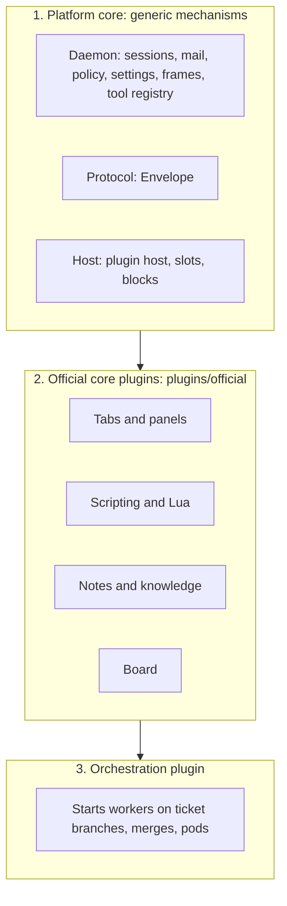
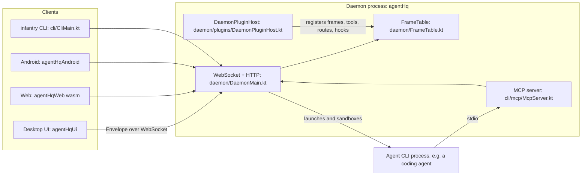
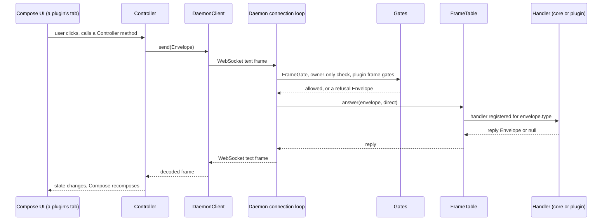
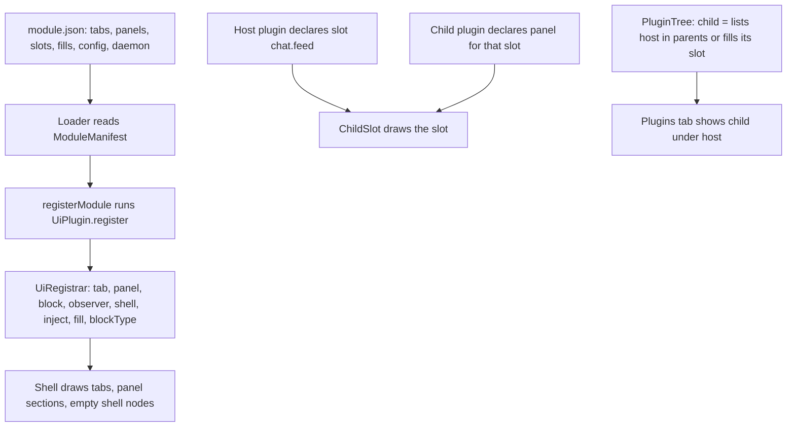
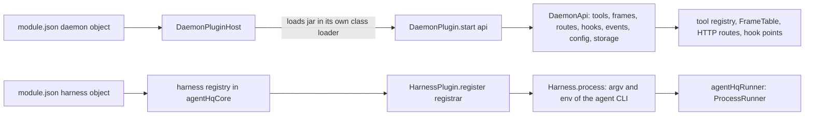
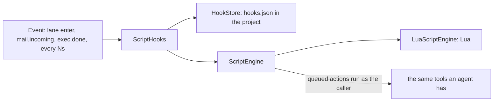

# Architecture

This page maps the system from the code. Each box names the source file that implements it. For rules and the build,
read `AGENTS.md` first; for the plugin details, follow the links at the end of each section.

## 1. The three layers

| Layer | What it holds | Where |
|---|---|---|
| Platform core | Only generic mechanisms: processes, sessions, mail routing, policy, scoped settings, the frame table, the plugin hosts, the wire protocol. | `superiorSoftLibrary/agentHq`, `agentHqCore`, `agentHqProtocol`, `agentHqRunner`, `agenthqUiCore`, `agenthqPlugins` |
| Official core plugins | Every feature of the app (a tab, the board, scripting). Same API as a community plugin. | `plugins/official/` |
| Orchestration | Running work: starting a worker on a ticket's own branch and tracking its outcome. Agents never depend on it. | `superiorSoftLibrary/agentHq/src/main/kotlin/com/superiorsoftllc/agenthq/orchestration/Orchestrator.kt`, guarded by `OrchestratorBoundaryGuardTest.kt` |

The direction is one way: a layer may use the one below it, never the reverse. The design record is
`docs/DAEMON-CORE.md` (dated; the code wins). Guards that enforce the line are listed in
AGENTS.md section 6.

## 2. Processes and modules

- **Daemon** (`agentHq`): one JVM process, started by `DaemonMain.kt`. It owns all state and runs with no UI
  (`agentHqHeadless` proves it). It serves a WebSocket (`/ws`) for clients, HTTP routes, and the browser bundle at `/`.
- **Protocol** (`agentHqProtocol`, `Protocol.kt`): every message is an `Envelope` (a type string plus a JSON payload).
  Client DTOs for the UI live in `agenthqUiCore` (commonMain), so the UI never depends on the JVM daemon.
- **Clients**: the desktop window (`agentHqUi`), the browser (`agentHqWeb`), Android (`agentHqAndroid`) all render the
  one shared UI in `agenthqUiCore`. The CLI (`CliMain.kt`) is another client of the same daemon.
- **Agents** are separate OS processes launched by a harness (section 5). They reach the daemon through the MCP
  server (`McpServer.kt`; plugin tools are exposed by `McpPluginTools.kt`) or the `agenthq` CLI.

## 3. A request, from a click to the daemon and back

| Step | Source |
|---|---|
| The UI composes a tab from a `UiPlugin` registration | `superiorSoftLibrary/agenthqUiCore/src/commonMain/kotlin/com/superiorsoftllc/agenthq/ui/plugin/TabFactory.kt` |
| `Controller` holds UI state and turns actions into frames | `superiorSoftLibrary/agenthqUiCore/src/commonMain/kotlin/com/superiorsoftllc/agenthq/ui/net/Controller.kt` |
| `DaemonClient.connect(url, token)` and `send(envelope)` | `superiorSoftLibrary/agenthqUiCore/src/commonMain/kotlin/com/superiorsoftllc/agenthq/ui/net/DaemonClient.kt` |
| `Envelope` is the wire type | `superiorSoftLibrary/agentHqProtocol/src/main/kotlin/com/superiorsoftllc/agenthq/protocol/Protocol.kt` |
| The connection loop applies `FrameGate.refusal(...)` and the plugins' own gates, then looks the frame up | `superiorSoftLibrary/agentHq/src/main/kotlin/com/superiorsoftllc/agenthq/daemon/DaemonMain.kt` |
| `FrameGate` lists owner-only frames; `FrameTable.register(types) { envelope, direct -> reply }` maps a type to its handler | `superiorSoftLibrary/agentHq/src/main/kotlin/com/superiorsoftllc/agenthq/daemon/FrameGate.kt`, `FrameTable.kt` |
| A plugin's frames are declared in `module.json` under `daemon.frames` (type, action, kind) and answered by its `DaemonPlugin` | `plugins/official/Infantry_Notes/module.json`, `plugins/official/Infantry_Notes/daemon/src/main/kotlin/com/superiorsoftllc/agenthq/plugins/official/notes/daemon/NotesDaemonPlugin.kt` |

Access control is by **action**: each frame, tool and route in a `module.json` names an `action` and a `kind`
(`read`, `write`, `destructive`). The access policy (`AccessPolicy` in `agentHqCore`) decides per caller, so a
visitor token or an agent's scoped token can be limited without the handler knowing.

Details: [Daemon plugin API](daemon-plugin-api.md) (frames, routes, hooks).

## 4. Plugins, slots and child plugins compose the UI

- **`module.json`** declares everything a plugin contributes; the host binds what is declared and refuses the rest.
  Type: `ModuleManifest` in `superiorSoftLibrary/agenthqPlugins/src/commonMain/kotlin/com/superiorsoftllc/agenthq/plugin/api/ModuleManifest.kt`.
- **`UiPlugin.register(registrar)`** is the entry point; `UiRegistrar` offers `tab`, `panel`, `interceptor`, `block`,
  `observer`, `shell`, `inject`, `fill`, `tabTree`, `implementation`, `blockType`, `fieldType`, `sessionBadge`
  (`TabFactory.kt`, above). `registerModule` runs it and collects the result into an `AgentHqModule`.
- **Slots**: a host lists a slot name in `slots` and draws it; a child declares a `panels` entry whose `panel` is the
  slot name. Example: `Infantry_Chat` draws `chat.feed` (`plugins/official/Infantry_Chat/src/ChatPanel.kt`) and
  `Infantry_ChatFeed` fills it (`plugins/official/Infantry_ChatFeed/module.json`).
- **PluginTree** decides who is a child of whom, for the Plugins tab and for enable/disable
  (`superiorSoftLibrary/agenthqPlugins/src/commonMain/kotlin/com/superiorsoftllc/agenthq/plugin/host/PluginTree.kt`).
- **Blocks**: a plugin can register block types and fill empty shell nodes with a tree of blocks as data
  (`fills`, `blockTypes`, `shell`, `inject` in `module.json`).
- **Loading**: on desktop, plugin jars are loaded at run time. Web and Android cannot, so they compile the same
  sources in (`superiorSoftLibrary/agenthqAppUi`, generated module list; see `settings.gradle.kts`).

Details: [UI plugin API](plugin-api.md), [Make a plugin](make-a-plugin.md), [Plugins](Plugins.md).

## 5. Daemon plugins and harnesses

- **Daemon half** (`DaemonPlugin`, `DaemonApi`, `DaemonTool` in
  `superiorSoftLibrary/agentHqDaemonApi/src/main/kotlin/com/superiorsoftllc/agenthq/daemon/api/DaemonApi.kt`): loaded
  by `daemon/plugins/DaemonPluginHost.kt` in a class loader that exposes only that API. A plugin that throws, or times
  out repeatedly, is disabled and the daemon carries on.
- **Harness half** (`HarnessPlugin`, `Harness`, `HarnessTranslator` in
  `superiorSoftLibrary/agentHqHarnessApi/src/main/kotlin/com/superiorsoftllc/agenthq/harness/api/HarnessApi.kt`; the
  host side in `HarnessHost.kt` of the same folder): a harness builds the argv and env of an agent CLI and translates
  its output lines into events. The daemon launches, sandboxes, gates and kills the process.

Details: [Daemon plugin API](daemon-plugin-api.md), [Harnesses](Harnesses.md).

## 6. Scripting and hooks

Core knows nothing of scripting or Lua (`CoreHasNoScriptingGuardTest.kt`). Two official plugins provide it:

- `plugins/official/Infantry_Scripting` owns the contract (`ScriptEngine.kt`), the hook dispatcher (`ScriptHooks.kt`),
  the hook store (`HookStore.kt`) and the hook tools (`HookTools.kt`), wired in `ScriptingDaemonPlugin.kt`, all under
  `plugins/official/Infantry_Scripting/daemon/src/main/kotlin/com/superiorsoftllc/agenthq/plugins/official/scripting/daemon/`.
- `plugins/official/Infantry_Lua` provides the language: `LuaScriptEngine.kt` and `LuaDaemonPlugin.kt` under
  `plugins/official/Infantry_Lua/daemon/src/main/kotlin/com/superiorsoftllc/agenthq/plugins/official/lua/daemon/`.

A script queues actions; after it ends the daemon runs them in order as the caller. A hook (`on`, `script`, `args`)
fires a script when an event happens. Details: [Scripting](Scripting.md).

## 7. Settings

A value has four scopes: session over role (in a project) over project over app over the built-in default
(`SettingScope`, `ScopedSettings` in
`superiorSoftLibrary/agentHqCore/src/main/kotlin/com/superiorsoftllc/agenthq/settings/ScopedSettings.kt`). Which scopes
a core key allows is `SettingScopes`, in the same file; a plugin declares its keys as `config` fields in its
`module.json`. Details: [Settings](Settings.md).
