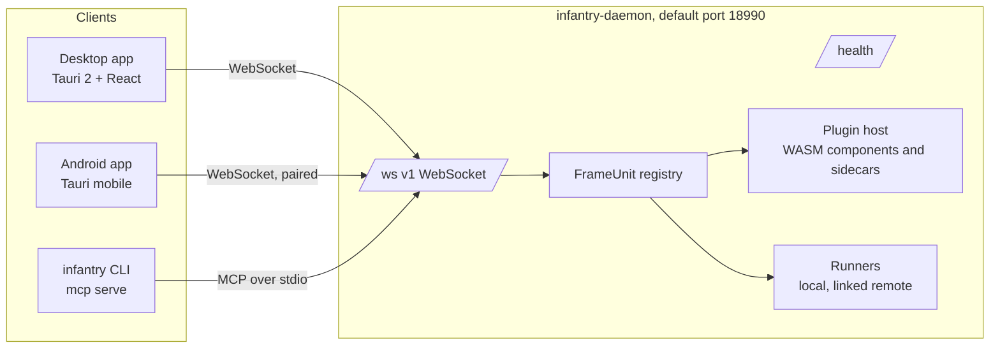
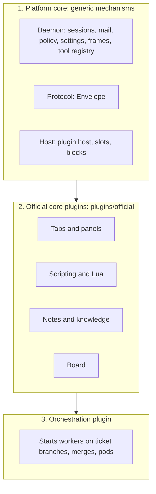
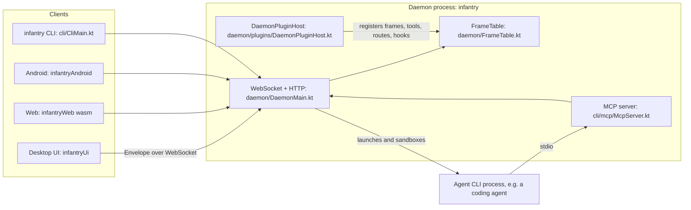
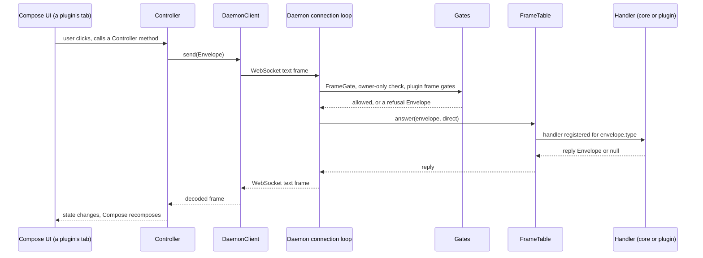
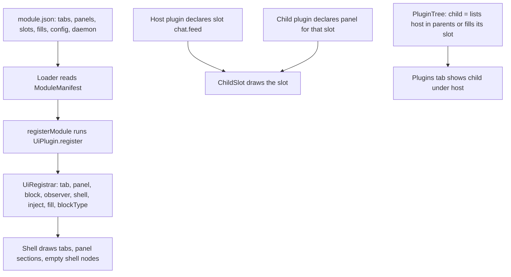
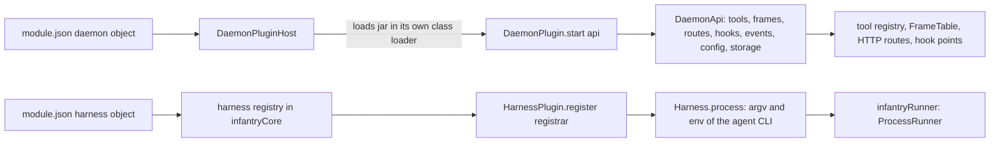
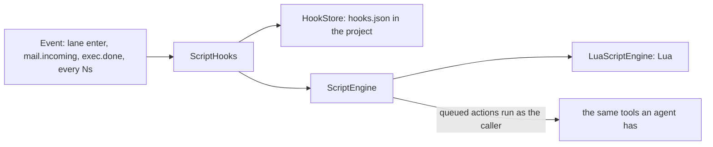

<!-- SPDX-License-Identifier: Apache-2.0 -->
[← Wiki index](index.md)

# Architecture

This page maps the Rust framework on `main` from the code. Each part names the crate or file that implements it. For the
rules and the commands, read [AGENTS.md](../../AGENTS.md) first. The Kotlin version of this page is kept at the end, under
the legacy heading.

> **legacy-java:** the Kotlin architecture is described in the legacy section at the end of this page, and in full on the `legacy-java` branch.

## 1. Shape of the system

Infantry AI is a command post for coding agents. One **daemon** owns the state: the ticket board, the agents' sessions,
the mail, the shared project knowledge, the scripts and the plugins. Clients connect to it over one WebSocket and never
own state themselves.

- The **desktop app** starts the daemon as a sidecar process when none is running for its state dir, then connects to it
  like any other daemon. The daemon outlives the window (`app/src-tauri/src/daemon.rs`).
- The **Android app** runs no daemon and no agents. It connects to a daemon on another machine, paired by an
  `infantry://connect` link or a QR code (`app/src-tauri/src/mobile.rs`).
- The **CLI** is the native `infantry` binary (`rust/crates/infantry-cli`). It serves `infantry mcp serve` and most
  other commands itself, so an agent's MCP bridge talks to the daemon directly.

## 2. The layers

Dependencies point down only. The table below is the layer map in `rust/crates/infantry-guards/src/layers.rs`; the
guard `every_workspace_crate_respects_the_layer_map` fails on an upward edge. The design record is
[docs/rust-port/LAYERS.md](../rust-port/LAYERS.md).

| Layer | Crates | What lives here |
|---|---|---|
| L0 wire | `infantry-protocol` | `Envelope`, the DTOs and the frame names. Byte-compatible with the Kotlin wire. |
| L1 platform core | `infantry-core`, `infantry-plugin-wit`, `infantry-plugin-host`, `infantry-plugin-sdk`, `infantry-usage`, `infantry-projects`, `infantry-knowledge`, `infantry-mail`, `infantry-scripting`, `infantry-vault` | Generic mechanisms: the `FrameUnit` registry, the event bus, the db handle, settings, the plugin ABI and host, usage and pacing, projects and worktrees, roles and skills, mail and notifications, Lua scripting, secrets. |
| L2 runner | `infantry-runner-api`, `infantry-runner`, `infantry-runner-local`, `infantry-runner-link` | Running agent processes: pseudo-terminals, Job Objects on Windows, a remote runner over a link. |
| L3 harnesses | `infantry-harness` (the contract), `infantry-harness-claude`, `-codex`, `-opencode`, `-pi` | One agent CLI each. An agent works with no orchestrator. |
| L4 orchestration | `infantry-orchestrator-api`, `infantry-board` | The board, tickets, epics and the pipeline seams. |
| Composition roots | `infantry-daemon`, `infantry-cli`, `infantry-migrate`, `app/src-tauri` (`infantry-tauri`) | They wire the layers together. Nothing depends on them. |
| Test only | `infantry-guards`, `conformance` | Guards that keep the rules, and a black-box WebSocket suite runnable against any daemon URL. |

Official feature plugins sit beside the layers, in `rust/plugins/official/`. Each one talks to the platform only through the
plugin ABI. See [Plugins](Plugins.md).

## 3. The daemon

Source: `rust/crates/infantry-daemon/src`.

- **Start:** `infantry-daemon [--port N] [--host H] [--state-dir DIR] [--mode both|runner|orchestrator]`. The defaults
  are `INFANTRY_PORT` (else **18990**), `INFANTRY_HOST` (else `127.0.0.1`), and `INFANTRY_STATE_DIR` (else
  `%LOCALAPPDATA%\SuperiorSoft\InfantryAI-Rust`). The daemon refuses port 8797, the Kotlin app's port.
- **Routes:** `/ws` is the v1 WebSocket that carries every session frame. `/health` answers without a token. Any other
  path goes to a plugin's HTTP route if one claims it, else 404.
- **Access** (`auth.rs`): with a token (`INFANTRY_TOKEN_FILE`, else `INFANTRY_TOKEN`) every route except `/health` needs
  `Authorization: Bearer <token>`. A bind on a non-loopback address needs a token. Without a token only the loopback Host
  is accepted. A request with an `Origin` header is refused, except a same-origin browser client on `/ws`.
- **Modes:** `both` (the default), `runner` (a runner-only daemon for a remote machine) and `orchestrator`.
- **Child processes:** every spawn goes through `infantry-proc`, which creates each child without a console window on
  Windows.
- **Harness launch:** a harness child gets `INFANTRY_PORT` and `INFANTRY_STATE_DIR` in its environment
  (`src/harness/launch.rs`).
- **Gateway mode (migration only):** with `--legacy-backend "<kotlin daemon command>"` the Rust daemon starts the Kotlin
  daemon on a private loopback port and forwards to it the frames no Rust unit owns (`src/gateway`). This is the bridge
  for the parts not yet ported; see [PARITY-GAPS](../rust-port/PARITY-GAPS.md).

## 4. The wire

`rust/crates/infantry-protocol/src/lib.rs` holds the contract. Each message is an `Envelope` with a frame `type`, a
`data` payload, an optional `sessionId`, a `requestId` and an `origin`. Frame names are listed in
`rust/crates/infantry-protocol/src/frames.rs`. The contract is versioned; a change is additive, and both ends move
together.

A request from the app runs this way:

1. The React app (`app/packages/client`) sends an `Envelope` over the WebSocket. In the desktop app the socket is opened
   from Rust (`tauri-plugin-websocket`), so no browser `Origin` is sent and the token rides as a `Bearer` header.
2. The daemon's `FrameUnit` registry finds the unit that owns the frame type. A core unit (board, mail, sessions, and so on)
   or a plugin's `handle-frame` export answers it.
3. The answer is an `Envelope` back on the same socket. Events (a ticket moved, a mail arrived, a session changed) go out
   on the daemon's event bus (`infantry-core`).

## 5. Plugins

A plugin is a folder with a `module.json` and a daemon half. The official plugins are in `rust/plugins/official/`.

- **Daemon half:** a WASM component (wasmtime, `wasm32-wasip2`) or a native sidecar speaking the same WIT world as JSON
  lines. The host calls exactly the exports of the `daemon-plugin` world (`start`, `stop`, `call-tool`, `handle-frame`,
  `handle-route`, `on-hook`, `on-event`) and links only the imports the manifest asks for.
- **Grants:** `module.json` `daemon.needs` and `daemon.wants` name the interfaces (`storage`, `events`, `http`, `settings`,
  `frames`). An ungranted interface is not linked.
- **Tiers and trust:** the official plugins build in this repo. The `PluginGuard` breaker in `infantry-plugin-host`
  stops a plugin that keeps failing.

See [Plugins](Plugins.md), [Make a plugin](make-a-plugin.md) and [Daemon plugin API](daemon-plugin-api.md).

## 6. Scripting, mail, runners and harnesses

- **Scripting:** `infantry-scripting` runs sandboxed Lua 5.2 (mlua). Scripts reach the daemon through the `ih.*` binding,
  and hooks run on event-bus events. See [Scripting](Scripting.md).
- **Mail and notifications:** `infantry-mail` holds the mailbox, the router, the notification bus, attention items and
  owner questions. See [Notifications](Notifications.md).
- **Runners:** `infantry-runner-local` runs a harness in a pseudo-terminal on this machine. `infantry-runner-link` runs it
  on a linked remote runner. See [Runners](runner-quickstart.md).
- **Harnesses:** `infantry-harness` is the contract (a launch plan plus a translator). Four harness crates implement it:
  Claude Code, Codex, opencode and pi. See [Harnesses](Harnesses.md).

## 7. Clients and shells

- **Desktop:** `app/src-tauri` is the Tauri 2 host. The window is the React app built by `app/shell` (Vite). It starts or
  finds the daemon, and it handles the updater ([Updates](Updates.md)).
- **Android:** the same React app in the Tauri mobile shell, paired to a remote daemon ([Android](Android.md)).
- **CLI:** `infantry mcp serve` and most commands are native. A command the native CLI lacks is handed to the Kotlin
  launcher (see [Command line](CommandLine.md)).

## 8. Where the state lives

- The daemon state dir is `%LOCALAPPDATA%\SuperiorSoft\InfantryAI-Rust` by default. The app keeps `ui.json` (settings
  such as the update channel and `remoteAccess`) and the remote-access token beside the daemon state.
- `infantry-migrate` snapshots a Kotlin state dir into a Rust one, read-only on the source, and verifies the copy.

## Legacy (Kotlin) reference

The Kotlin architecture is kept below, unchanged except for the heading levels. It describes the Kotlin app on the
`legacy-java` branch and is not what main runs.

## Architecture

This page maps the system from the code. Each box names the source file that implements it. For rules and the build,
read `AGENTS.md` first; for the plugin details, follow the links at the end of each section.

### 1. The three layers

| Layer | What it holds | Where |
|---|---|---|
| Platform core | Only generic mechanisms: processes, sessions, mail routing, policy, scoped settings, the frame table, the plugin hosts, the wire protocol. | `superiorSoftLibrary/infantry`, `infantryCore`, `infantryProtocol`, `infantryRunner`, `infantryUiCore`, `infantryPlugins` |
| Official core plugins | Every feature of the app (a tab, the board, scripting). Same API as a community plugin. | `plugins/official/` |
| Orchestration | Running work: starting a worker on a ticket's own branch and tracking its outcome. Agents never depend on it. | `superiorSoftLibrary/infantry/src/main/kotlin/com/superiorsoftllc/infantry/orchestration/Orchestrator.kt`, guarded by `OrchestratorBoundaryGuardTest.kt` |

The direction is one way: a layer may use the one below it, never the reverse. The design record is
`docs/DAEMON-CORE.md` (dated; the code wins). Guards that enforce the line are listed in
AGENTS.md section 6.

### The framework stays generic

Infantry AI is a framework. Core, the SDK and the framework tools (plugin mechanisms, run commands, testing tools such
as the UI driver) are generic mechanisms that any app can use unchanged.

- Vendor- or business-specific behaviour never goes into core or the SDK. That means a company's hosting, billing and
  payments, accounts, endpoints, or its own workflow. It lives in plugins, scripts, role personas, config and data, or
  in examples that use the generic tools. A hosting service plugin is the model: the plugin owns the service, core only
  offers the seams it plugs into.
- The test: could a stranger's app use this unchanged? If not, it does not belong in core or the SDK.
- A new core or SDK seam is proposed and approved before it is built. If a feature seems to need core, the missing piece
  is usually a generic seam: propose that seam, not the feature.

The same rule is AGENTS.md rules 1 and 2; the layers above are how it is organised.

### 2. Processes and modules

- **Daemon** (`infantry`): one JVM process, started by `DaemonMain.kt`. It owns all state and runs with no UI
  (`infantryHeadless` proves it). It serves a WebSocket (`/ws`) for clients, HTTP routes, and the browser bundle at `/`.
- **Protocol** (`infantryProtocol`, `Protocol.kt`): every message is an `Envelope` (a type string plus a JSON payload).
  Client DTOs for the UI live in `infantryUiCore` (commonMain), so the UI never depends on the JVM daemon.
- **Clients**: the desktop window (`infantryUi`), the browser (`infantryWeb`), Android (`infantryAndroid`) all render the
  one shared UI in `infantryUiCore`. The CLI (`CliMain.kt`) is another client of the same daemon.
- **Agents** are separate OS processes launched by a harness (section 5). They reach the daemon through the MCP
  server (`McpServer.kt`; plugin tools are exposed by `McpPluginTools.kt`) or the `infantry` CLI.

### 3. A request, from a click to the daemon and back

| Step | Source |
|---|---|
| The UI composes a tab from a `UiPlugin` registration | `superiorSoftLibrary/infantryUiCore/src/commonMain/kotlin/com/superiorsoftllc/infantry/ui/plugin/TabFactory.kt` |
| `Controller` holds UI state and turns actions into frames | `superiorSoftLibrary/infantryUiCore/src/commonMain/kotlin/com/superiorsoftllc/infantry/ui/net/Controller.kt` |
| `DaemonClient.connect(url, token)` and `send(envelope)` | `superiorSoftLibrary/infantryUiCore/src/commonMain/kotlin/com/superiorsoftllc/infantry/ui/net/DaemonClient.kt` |
| `Envelope` is the wire type | `superiorSoftLibrary/infantryProtocol/src/main/kotlin/com/superiorsoftllc/infantry/protocol/Protocol.kt` |
| The connection loop applies `FrameGate.refusal(...)` and the plugins' own gates, then looks the frame up | `superiorSoftLibrary/infantry/src/main/kotlin/com/superiorsoftllc/infantry/daemon/DaemonMain.kt` |
| `FrameGate` lists owner-only frames; `FrameTable.register(types) { envelope, direct -> reply }` maps a type to its handler | `superiorSoftLibrary/infantry/src/main/kotlin/com/superiorsoftllc/infantry/daemon/FrameGate.kt`, `FrameTable.kt` |
| A plugin's frames are declared in `module.json` under `daemon.frames` (type, action, kind) and answered by its `DaemonPlugin` | `plugins/official/Infantry_Notes/module.json`, `plugins/official/Infantry_Notes/daemon/src/main/kotlin/com/superiorsoftllc/infantry/plugins/official/notes/daemon/NotesDaemonPlugin.kt` |

Access control is by **action**: each frame, tool and route in a `module.json` names an `action` and a `kind`
(`read`, `write`, `destructive`). The access policy (`AccessPolicy` in `infantryCore`) decides per caller, so a
visitor token or an agent's scoped token can be limited without the handler knowing.

Details: [Daemon plugin API](daemon-plugin-api.md) (frames, routes, hooks).

### 4. Plugins, slots and child plugins compose the UI

- **`module.json`** declares everything a plugin contributes; the host binds what is declared and refuses the rest.
  Type: `ModuleManifest` in `superiorSoftLibrary/infantryPlugins/src/commonMain/kotlin/com/superiorsoftllc/infantry/plugin/api/ModuleManifest.kt`.
- **`UiPlugin.register(registrar)`** is the entry point; `UiRegistrar` offers `tab`, `panel`, `interceptor`, `block`,
  `observer`, `shell`, `inject`, `fill`, `tabTree`, `implementation`, `blockType`, `fieldType`, `sessionBadge`
  (`TabFactory.kt`, above). `registerModule` runs it and collects the result into an `InfantryModule`.
- **Slots**: a host lists a slot name in `slots` and draws it; a child declares a `panels` entry whose `panel` is the
  slot name. Example: `Infantry_Chat` draws `chat.feed` (`plugins/official/Infantry_Chat/src/ChatPanel.kt`) and
  `Infantry_ChatFeed` fills it (`plugins/official/Infantry_ChatFeed/module.json`).
- **PluginTree** decides who is a child of whom, for the Plugins tab and for enable/disable
  (`superiorSoftLibrary/infantryPlugins/src/commonMain/kotlin/com/superiorsoftllc/infantry/plugin/host/PluginTree.kt`).
- **Blocks**: a plugin can register block types and fill empty shell nodes with a tree of blocks as data
  (`fills`, `blockTypes`, `shell`, `inject` in `module.json`).
- **Loading**: on desktop, plugin jars are loaded at run time. Web and Android cannot, so they compile the same
  sources in (`superiorSoftLibrary/infantryAppUi`, generated module list; see `settings.gradle.kts`).

Details: [UI plugin API](plugin-api.md), [Make a plugin](make-a-plugin.md), [Plugins](Plugins.md).

### 5. Daemon plugins and harnesses

- **Daemon half** (`DaemonPlugin`, `DaemonApi`, `DaemonTool` in
  `superiorSoftLibrary/infantryDaemonApi/src/main/kotlin/com/superiorsoftllc/infantry/daemon/api/DaemonApi.kt`): loaded
  by `daemon/plugins/DaemonPluginHost.kt` in a class loader that exposes only that API. A plugin that throws, or times
  out repeatedly, is disabled and the daemon carries on.
- **Harness half** (`HarnessPlugin`, `Harness`, `HarnessTranslator` in
  `superiorSoftLibrary/infantryHarnessApi/src/main/kotlin/com/superiorsoftllc/infantry/harness/api/HarnessApi.kt`; the
  host side in `HarnessHost.kt` of the same folder): a harness builds the argv and env of an agent CLI and translates
  its output lines into events. The daemon launches, sandboxes, gates and kills the process.

Details: [Daemon plugin API](daemon-plugin-api.md), [Harnesses](Harnesses.md).

### 6. Scripting and hooks

Core knows nothing of scripting or Lua (`CoreHasNoScriptingGuardTest.kt`). Two official plugins provide it:

- `plugins/official/Infantry_Scripting` owns the contract (`ScriptEngine.kt`), the hook dispatcher (`ScriptHooks.kt`),
  the hook store (`HookStore.kt`) and the hook tools (`HookTools.kt`), wired in `ScriptingDaemonPlugin.kt`, all under
  `plugins/official/Infantry_Scripting/daemon/src/main/kotlin/com/superiorsoftllc/infantry/plugins/official/scripting/daemon/`.
- `plugins/official/Infantry_Lua` provides the language: `LuaScriptEngine.kt` and `LuaDaemonPlugin.kt` under
  `plugins/official/Infantry_Lua/daemon/src/main/kotlin/com/superiorsoftllc/infantry/plugins/official/lua/daemon/`.

A script queues actions; after it ends the daemon runs them in order as the caller. A hook (`on`, `script`, `args`)
fires a script when an event happens. Details: [Scripting](Scripting.md).

### 7. Settings

A value has four scopes: session over role (in a project) over project over app over the built-in default
(`SettingScope`, `ScopedSettings` in
`superiorSoftLibrary/infantryCore/src/main/kotlin/com/superiorsoftllc/infantry/settings/ScopedSettings.kt`). Which scopes
a core key allows is `SettingScopes`, in the same file; a plugin declares its keys as `config` fields in its
`module.json`. Details: [Settings](Settings.md).
