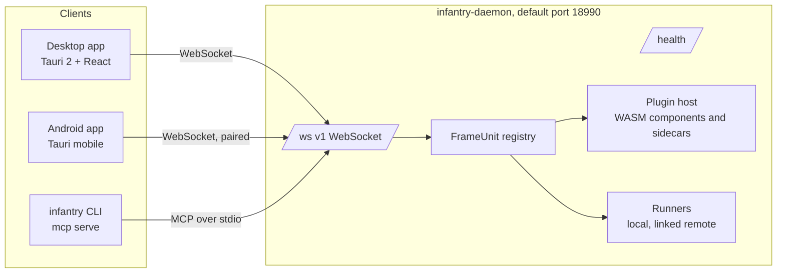

<!-- SPDX-License-Identifier: Apache-2.0 -->
[← Wiki index](../index.md)

# Architecture

This page maps the Rust framework on `main` from the code. Each part names the crate or file that implements it. For the
rules and the commands, read `AGENTS.md` at the repo root first.

## 1. Shape of the system

Infantry AI runs on **BattalionOS**: the MPL-2.0 platform core and shell (daemon core, protocol, runner, desktop shell). Infantry AI is the orchestrator app on top. Crate and package names keep the `infantry` prefix for now.

Infantry AI is a command post for coding agents. One **daemon** owns the state: the ticket board, the agents' sessions,
the mail, the shared project knowledge, the scripts and the plugins. Clients connect to it over one WebSocket and never
own state themselves.

- The **desktop app** starts the daemon as a sidecar process when none is running for its state dir, then connects to it
  like any other daemon. The daemon outlives the window (`app/src-tauri/src/daemon.rs`).
- The **Android app** runs no daemon and no agents. It connects to a daemon on another machine, paired by an
  `infantry://connect` link or a QR code (`app/src-tauri/src/mobile.rs`).
- The **CLI** is the native `infantry` binary (`rust/crates/infantry-cli`). It serves `infantry mcp serve` and most
  other commands itself, so an agent's MCP bridge talks to the daemon directly.

## 2. The layers

Dependencies point down only. The table below is the layer map in `rust/crates/infantry-guards/src/layers.rs`; the
guard `every_workspace_crate_respects_the_layer_map` fails on an upward edge. The design record is
`docs/rust-port/LAYERS.md`.

| Layer | Crates | What lives here |
|---|---|---|
| L0 wire | `infantry-protocol` | `Envelope`, the DTOs and the frame names. |
| L1 platform core | `infantry-core`, `infantry-plugin-wit`, `infantry-plugin-host`, `infantry-plugin-sdk`, `infantry-usage`, `infantry-projects`, `infantry-knowledge`, `infantry-mail`, `infantry-scripting`, `infantry-vault` | Generic mechanisms: the `FrameUnit` registry, the event bus, the db handle, settings, the plugin ABI and host, usage and pacing, projects and worktrees, roles and skills, mail and notifications, Lua scripting, secrets. |
| L2 runner | `infantry-runner-api`, `infantry-runner`, `infantry-runner-local`, `infantry-runner-link` | Running agent processes: pseudo-terminals, Job Objects on Windows, a remote runner over a link. |
| L3 harnesses | `infantry-harness` (the contract), `infantry-harness-claude`, `-codex`, `-opencode`, `-pi` | One agent CLI each. An agent works with no orchestrator. |
| L4 orchestration | `infantry-orchestrator-api`, `infantry-board` | The board, tickets, epics and the pipeline seams. |
| Composition roots | `infantry-daemon`, `infantry-cli`, `infantry-migrate`, `app/src-tauri` (`infantry-tauri`) | They wire the layers together. Nothing depends on them. |
| Test only | `infantry-guards`, `conformance` | Guards that keep the rules, and a black-box WebSocket suite runnable against any daemon URL. |

Official feature plugins sit beside the layers, in `rust/plugins/official/`. Each one talks to the platform only through the
plugin ABI. See [Plugins](../plugins/overview.md).

## 3. The daemon

Source: `rust/crates/infantry-daemon/src`.

- **Start:** `infantry-daemon [--port N] [--host H] [--state-dir DIR] [--mode both|runner|orchestrator]`. The defaults
  are `INFANTRY_PORT` (else **18990**), `INFANTRY_HOST` (else `127.0.0.1`), and `INFANTRY_STATE_DIR` (else
  `%LOCALAPPDATA%\SuperiorSoft\InfantryAI-Rust`). The daemon refuses port 8797 (reserved for the owner's tools).
- **Routes:** `/ws` is the v1 WebSocket that carries every session frame. `/health` answers without a token. Any other
  path goes to a plugin's HTTP route if one claims it, else 404.
- **Access** (`auth.rs`): with a token (`INFANTRY_TOKEN_FILE`, else `INFANTRY_TOKEN`) every route except `/health` needs
  `Authorization: Bearer <token>`. A bind on a non-loopback address needs a token. Without a token only the loopback Host
  is accepted. A request with an `Origin` header is refused, except a same-origin browser client on `/ws`.
- **Modes:** `both` (the default), `runner` (a runner-only daemon for a remote machine) and `orchestrator`.
- **Child processes:** every spawn goes through `infantry-proc`, which creates each child without a console window on
  Windows.
- **Harness launch:** a harness child gets `INFANTRY_PORT` and `INFANTRY_STATE_DIR` in its environment
  (`src/harness/launch.rs`).
- **Gateway mode (migration only):** with `--legacy-backend "<legacy daemon command>"` the Rust daemon starts the legacy
  daemon (the `legacy-java` branch) on a private loopback port and forwards to it the frames no Rust unit owns (`src/gateway`). This is the bridge
  for the parts not yet ported.

## 4. The wire

`rust/crates/infantry-protocol/src/lib.rs` holds the contract. Each message is an `Envelope` with a frame `type`, a
`data` payload, an optional `sessionId`, a `requestId` and an `origin`. Frame names are listed in
`rust/crates/infantry-protocol/src/frames.rs`. The contract is versioned; a change is additive, and both ends move
together.

A request from the app runs this way:

1. The React app (`app/packages/client`) sends an `Envelope` over the WebSocket. In the desktop app the socket is opened
   from Rust (`tauri-plugin-websocket`), so no browser `Origin` is sent and the token rides as a `Bearer` header.
2. The daemon's `FrameUnit` registry finds the unit that owns the frame type. A core unit (board, mail, sessions, and so on)
   or a plugin's `handle-frame` export answers it.
3. The answer is an `Envelope` back on the same socket. Events (a ticket moved, a mail arrived, a session changed) go out
   on the daemon's event bus (`infantry-core`).

## 5. Plugins

A plugin is a folder with a `module.json` and a daemon half. The official plugins are in `rust/plugins/official/`.

- **Daemon half:** a WASM component (wasmtime, `wasm32-wasip2`) or a native sidecar speaking the same WIT world as JSON
  lines. The host calls exactly the exports of the `daemon-plugin` world (`start`, `stop`, `call-tool`, `handle-frame`,
  `handle-route`, `on-hook`, `on-event`) and links only the imports the manifest asks for.
- **Grants:** `module.json` `daemon.needs` and `daemon.wants` name the interfaces (`storage`, `events`, `http`, `settings`,
  `frames`). An ungranted interface is not linked.
- **Tiers and trust:** the official plugins build in this repo. The `PluginGuard` breaker in `infantry-plugin-host`
  stops a plugin that keeps failing.

See [Plugins](../plugins/overview.md), [Create a plugin](../plugins/create.md) and [Daemon tools](../plugins/daemon-tools.md).

## 6. Scripting, mail, runners and harnesses

- **Scripting:** `infantry-scripting` runs sandboxed Lua 5.2 (mlua). Scripts reach the daemon through the `ih.*` binding,
  and hooks run on event-bus events. See [Knowledge, scripting, settings](../knowledge-scripting-settings.md) and the [Lua API](../reference/lua-api.md).
- **Mail and notifications:** `infantry-mail` holds the mailbox, the router, the notification bus, attention items and
  owner questions. See [Mail and decisions](../mail-and-decisions.md).
- **Runners:** `infantry-runner-local` runs a harness in a pseudo-terminal on this machine. `infantry-runner-link` runs it
  on a linked remote runner. See [Remote runners](../remote-runners.md).
- **Harnesses:** `infantry-harness` is the contract (a launch plan plus a translator). Four harness crates implement it:
  Claude Code, Codex, opencode and pi. See [Providers and models](../providers-and-models.md) and [Add a harness](add-a-harness.md).

## 7. Clients and shells

- **Desktop:** `app/src-tauri` is the Tauri 2 host. The window is the React app built by `app/shell` (Vite). It starts or
  finds the daemon, and it handles the updater ([Install the desktop app](../install-desktop.md)).
- **Android:** the same React app in the Tauri mobile shell, paired to a remote daemon ([Phone app](../phone.md)).
- **CLI:** `infantry mcp serve` and most commands are native. A command the native CLI lacks is handed to the legacy
  launcher (see the [CLI reference](../reference/cli.md)).

## 8. Where the state lives

- The daemon state dir is `%LOCALAPPDATA%\SuperiorSoft\InfantryAI-Rust` by default. The app keeps `ui.json` (settings
  such as the update channel and `remoteAccess`) and the remote-access token beside the daemon state.
- `infantry-migrate` snapshots a legacy (`legacy-java`) state dir into a Rust one, read-only on the source, and verifies the copy.

